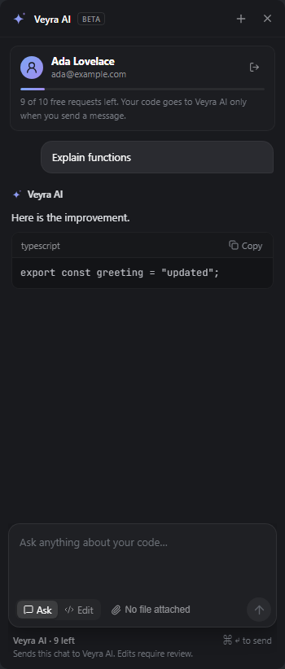
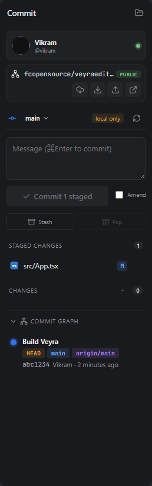
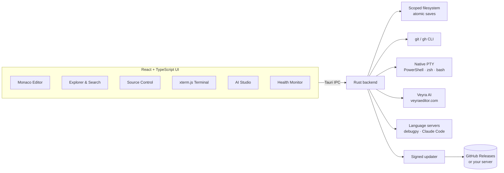

<div align="center">


# Veyra Studio

### The lightweight VS Code alternative.

[](https://veyraeditor.com)

The Monaco editor you know from VS Code, in a fast native app that's a tenth of the download size.<br/>
Git, a real terminal, a Python debugger and Veyra AI are built in. Free and open source.

[](https://github.com/fcopensource/veyraeditor/releases/latest)
[](https://github.com/fcopensource/veyraeditor/actions/workflows/release.yml)
[](https://github.com/fcopensource/veyraeditor/releases)
[](#-download)
[](LICENSE)

[](https://tauri.app/)
[](https://www.rust-lang.org/)
[](https://microsoft.github.io/monaco-editor/)
[](https://react.dev/)
[](https://www.typescriptlang.org/)

**[⬇️ Download](#-download)** · [Website](https://veyraeditor.com) · [Veyra vs VS Code](#-veyra-vs-vs-code) · [What's new](#-whats-new-in-010) · [Features](#-features) · [AI Studio](#-ai-studio) · [Build from source](#-build-from-source) · [Roadmap](#-roadmap)

</div>

<br/>

<p align="center">
  
</p>

<table>
  <tr>
    <td width="50%" align="center"><br/><sub><b>A launch screen</b> while Veyra starts</sub></td>
    <td width="50%" align="center"><br/><sub><b>A calm first screen</b>: only Welcome until you open a project</sub></td>
  </tr>
</table>

<table>
  <tr>
    <td align="center" valign="top"><br/><sub><b>Veyra AI</b>: code in cards, edits you review</sub></td>
    <td align="center" valign="top"><br/><sub><b>Git</b>: one colour per kind of change</sub></td>
    <td valign="top">

### Built to feel like home

- **Same editor as VS Code.** Monaco, IntelliSense, multi-cursor, the command palette and the shortcuts you already know.
- **Lighter on memory.** One small Rust process and the web view built into your OS. No bundled Chromium, no Node.js runtime, no extension host.
- **Small and quick.** The Windows installer is about 8 MB. VS Code's is about 100 MB.
- **Everything included.** Git, a real terminal, Live Server, a Python debugger and Veyra AI work out of the box.
- **Private by default.** No telemetry. Your code only leaves your machine when you send it to AI.

</td>
  </tr>
</table>

---

## 🆚 Veyra vs VS Code

Veyra is for developers who love VS Code's editor but not its weight.

| | **Veyra Studio** | VS Code |
| --- | --- | --- |
| **Built with** | Rust + the system web view (Tauri) | Electron (bundled Chromium + Node.js) |
| **Installer size** | ~8 MB on Windows, ~12 MB on macOS | ~100 MB |
| **Memory** | Lighter: one Rust process plus the OS web view, no extension host | Heavier: its own browser engine, plus separate window, GPU and extension-host processes |
| **Editor** | Monaco, the same engine | Monaco |
| **Shortcuts** | VS Code's: `Ctrl+P`, `Ctrl+Shift+P`, `Ctrl+B` and more | — |
| **Language tools** | TypeScript, ESLint, Prettier, Tailwind, Emmet, Svelte, Vue and Python in one click | Extensions |
| **AI** | Veyra AI built in, free requests with a free account | GitHub Copilot (extension) |
| **Telemetry** | None | On by default |
| **Price** | Free, MIT licensed | Free |

**Fair to know:** VS Code extensions that run their own code don't work in Veyra yet (themes and snippets from Open VSX do), and the debugger covers Python today. Both are on the [roadmap](#-roadmap). Want to see the memory difference on your own machine? Open the same project in both and compare them in Task Manager or Activity Monitor: [here's how](https://veyraeditor.com/blog/lightweight-vs-code-alternative-less-memory).

---

## 🎉 What's new in 0.10

A complete redesign, inspired by Android Studio:

- 🏝️ **Islands theme:** rounded panels, calmer colours and JetBrains Mono in the editor.
- 🪟 **One title bar** on Windows and Linux, with the menu behind ☰ and built-in window buttons.
- 🚀 **A launch screen**, and a calm first screen that shows only Welcome until you open a project.
- 📁 **New file and folder icons:** folders coloured by role (source, tests, assets, build, config) and files with language badges.
- 🌿 **Clearer Git colours:** blue for modified, green for added, red for deleted, violet for renamed, and labelled branches in the commit graph.
- ✨ **A new Veyra AI:** a simpler logo, a redesigned panel, code cards with Copy, and a single message box.
- 🔒 **Security updates** across the TLS libraries, the updater and the web content sanitiser.

Full notes in the [changelog](CHANGELOG.md).

---

## 📥 Download

**[Download the latest release](https://github.com/fcopensource/veyraeditor/releases/latest)**, or get it from **[veyraeditor.com](https://veyraeditor.com/download)**.

| Platform | Installer | Notes |
| --- | --- | --- |
| **Windows** 10 / 11 | [Microsoft Store](https://apps.microsoft.com/detail/XP8LKHC447THM1) (recommended) · `Veyra.Studio_x.y.z_x64-setup.exe` · `.msi` | WebView2 is installed automatically if missing |
| **macOS** · Apple silicon | `Veyra.Studio_x.y.z_aarch64.dmg` | macOS 11 or newer |
| **macOS** · Intel | `Veyra.Studio_x.y.z_x64.dmg` | macOS 11 or newer |
| **Linux** | `.AppImage` (any distro) · `.deb` (Ubuntu/Debian) · `.rpm` (Fedora) | Requires WebKitGTK 4.1 |

**Veyra updates itself.** Installed copies check for new versions on launch and every few hours, verify the download's signature, and turn the top-right button into **Update** when a new version is ready. You can also choose **Help → Check for Updates…**.

> [!NOTE]
> The Microsoft Store version is signed and trusted by Windows. The GitHub installers are not yet signed by Microsoft or Apple. On **Windows**, SmartScreen may show *"Windows protected your PC"*: choose **More info → Run anyway**. On **macOS**, drag the app to Applications and open it once, then go to **System Settings → Privacy & Security → Open Anyway**.

---

## ✨ Features

| Area | What you get |
| --- | --- |
| **Editor** | Monaco (the editor behind VS Code): syntax highlighting for 80+ languages, multi-cursor, find & replace, formatting, sticky scroll, minimap |
| **Language tools** | One-click IntelliSense from the same language servers VS Code uses: TypeScript/JavaScript, ESLint, Prettier, Tailwind CSS, Emmet, Svelte, Vue and **Python (Pyright)** |
| **Debugger** | Python debugging like VS Code: gutter breakpoints, step over/into/out, variables, watch, call stack and a Debug Console. See [Debugging](#-debugging) |
| **Explorer** | Real local folders, nested create, rename, copy/cut/paste, duplicate, drag-and-drop, multi-select, move to Trash/Recycle Bin, reveal in Finder/File Explorer |
| **Tabs & navigation** | Multiple tabs with preserved unsaved buffers, Quick Open, command palette, workspace text search, symbol outline, Problems panel |
| **Terminal** | Real shells via a native PTY: PowerShell on Windows, your login shell on macOS/Linux. Multiple named sessions, plus "Run active file" |
| **Git** | Change markers in the gutter, file-tree badges, side-by-side diffs, branches, sync, stash, amend, history. See [Git, built in](#-git-built-in) |
| **AI Studio** | Chat, explain, and reviewed edits with Veyra AI. Sign in with a free Veyra account: 10 free requests, no API key. See [AI Studio](#-ai-studio) |
| **Health monitor** | A live 0–100 score in the status bar, plus a panel checking the backend, UI responsiveness, memory, errors, Git and shell, with a fix hint for each problem |
| **Safe saving** | Atomic writes, detection of external changes, protection against silently overwriting files edited elsewhere, confirmation before closing unsaved work |
| **Extensions** | Open VSX marketplace with real icons, ratings and a full page per extension. Themes and snippets install directly; popular extensions (ESLint, Prettier, Volar, Python Debugger, **Claude Code** and more) install Veyra's built-in equivalent |
| **Claude Code** | Anthropic's coding agent installs with its official installer and opens in your project's terminal in one click |
| **Veyra Live Server** | **Go Live** serves your folder with live reload; CSS updates without a reload. Built in, no Node.js needed. See [Live Server](#-live-server) |
| **Customization** | The Islands dark theme (inspired by Android Studio) and a light theme, Open VSX themes & snippets or VSIX import, font size, word wrap, minimap, resizable panels, split view |
| **Updates** | Signed automatic updates on every platform |

---

## 🐞 Debugging

Open **Run and Debug** (the bug icon) and click **Install** once. Veyra installs Microsoft's `debugpy` into its own app folder, never into your project.

- Click beside a line number (or press **F9**) to set a breakpoint, then press **F5** to debug the open Python file.
- Step over (**F10**), into (**F11**) and out (**Shift + F11**); continue (**F5**), restart, or stop (**Shift + F5**).
- Inspect **Variables** to any depth, add **Watch** expressions, switch frames in the **Call stack**, and evaluate code in the **Debug Console**.
- Breakpoints follow your edits and are remembered per project. Your project's `.venv` is used automatically.

Requires Python 3.8 or newer. Node.js and TypeScript debugging is next.

---

## 📡 Live Server


**Veyra Live Server: save, see it, instantly.** More at [veyraeditor.com/live-server](https://veyraeditor.com/live-server).

Click **Go Live** in the status bar (or right-click an HTML file → **Open with Live Server**, or press **Alt+L Alt+O**). Veyra serves your folder at `http://127.0.0.1:5500` and opens the page in your browser.

- Saving HTML or JavaScript reloads the page; saving CSS swaps the stylesheet in place, without a reload.
- Folders without an `index.html` show a file listing.
- Built into Veyra in Rust: nothing to install and no Node.js needed. It listens on `127.0.0.1` only and never serves files outside the folder.

**Also for VS Code.** Veyra also makes [**Veyra Port Manager**](extensions/port-manager) for VS Code: every port in use and the app behind it, with one-click Open, Copy and Stop (`flightcoders.veyra-port-manager`).

The same Live Server is a VS Code extension in [`extensions/live-server`](extensions/live-server), sharing the browser script with Veyra. Install it from the [Visual Studio Marketplace](https://marketplace.visualstudio.com/items?itemName=flightcoders.veyra-live-server) or search for **Veyra Live Server** in VS Code's Extensions view (ID `flightcoders.veyra-live-server`). Each Veyra release also attaches `veyra-live-server-<version>.vsix` for offline installs.

---

## 🧠 AI Studio

Open it with the **Veyra AI** button in the top bar or **Ctrl/⌘ + L**, or select code and press **Ctrl/⌘ + K** to edit the selection with AI.

**Veyra AI, no API key**
- AI Studio uses **Veyra AI** only. Open the AI panel and sign in with your free [Veyra account](https://veyraeditor.com/register).
- Every account gets **10 free Veyra AI requests in total**. A request that fails isn't counted.
- Requests go to veyraeditor.com, which forwards them to the AI provider. The provider key lives only on that server and never reaches the app.
- The app keeps only a revocable sign-in token, in a private file in Veyra's app data folder. Sign out anytime from the AI panel.

**You stay in control**
- AI only sees the conversation plus what you explicitly attach: the current file, a selection, or *Smart workspace context*. Veyra picks the relevant files and shows you which ones were sent.
- Proposed edits open in a side-by-side diff. Applying updates the editor buffer only. Undo with **Ctrl/⌘ + Z**; nothing is saved until you save.
- Files that look like secrets trigger a warning before they are sent, and smart context never includes `.env` files, keys or gitignored files.
- AI never runs commands or writes files on its own.

---

## 🌿 Git, built in

- **Gutter markers:** green for added lines, blue for modified, red for deletions. They update live as you type, against `HEAD`.
- **Explorer badges:** `M` modified · `U` untracked · `A` added · `D` deleted · `R` renamed, plus a dot on folders containing changes.
- **Side-by-side diff** against `HEAD` for any changed file, with an inline toggle.
- **Stage / unstage / discard** per file or all at once. Discarding never deletes untracked files.
- **Commit** with **Ctrl/⌘ + Enter**, or **amend** the last commit.
- **Branches:** switch or create from the branch picker.
- **Sync:** ahead/behind counts in the panel and status bar, with one-click pull + push.
- **Stash / Pop**, **file history** for the active file, and a **commit graph**.
- **GitHub:** sign in with the GitHub CLI, fetch/pull/push, and open the repository on github.com.
- Status refreshes automatically every 10 seconds and whenever you return to the window.

---

## ⌨️ Keyboard shortcuts

Shortcuts follow your platform: **Ctrl** on Windows/Linux, **⌘** on macOS.

| Shortcut | Action |
| --- | --- |
| `Ctrl/⌘ + P` | Quick Open (go to file) |
| `Ctrl/⌘ + Shift + P` | Command palette |
| `Ctrl/⌘ + O` · `Ctrl/⌘ + N` | Open folder · New file |
| `Ctrl/⌘ + S` · `Ctrl/⌘ + Shift + S` | Save · Save all |
| `Ctrl/⌘ + W` | Close editor |
| `Ctrl/⌘ + F` · `Ctrl/⌘ + Shift + F` | Find in file · Search workspace |
| `Ctrl/⌘ + D` · `Ctrl/⌘ + Shift + L` | Add next occurrence · Select all occurrences |
| `Alt + ↑/↓` · `Alt + Shift + ↑/↓` | Move line · Copy line |
| `F12` · `Shift + F12` · `Ctrl + G` | Go to definition · References · Line |
| `Ctrl/⌘ + B` | Toggle sidebar |
| ``Ctrl + ` `` · ``Ctrl + Shift + ` `` | Terminal · New terminal |
| `Ctrl + Alt + N` | Run active file |
| `F5` · `Shift + F5` | Start or continue debugging · Stop |
| `F9` · `F10` · `F11` · `Shift + F11` | Toggle breakpoint · Step over · Step into · Step out |
| `Alt + L` `Alt + O` · `Alt + L` `Alt + C` | Open with Live Server · Stop Live Server |
| `Ctrl/⌘ + L` · `Ctrl/⌘ + K` | Toggle AI · Edit selection with AI |
| `Ctrl/⌘ + ,` | Settings |

---

## 🛠 Build from source

**Prerequisites:** [Node.js 22+](https://nodejs.org), [Rust (stable)](https://rustup.rs), Git, and the [Tauri system dependencies](https://tauri.app/start/prerequisites/) for your OS: WebView2 (preinstalled on Windows 11), Xcode Command Line Tools on macOS, WebKitGTK 4.1 on Linux.

```bash
git clone https://github.com/fcopensource/veyraeditor.git
cd veyraeditor
npm ci
npm run tauri dev       # full desktop app with native filesystem, Git and terminal
```

The first Rust build compiles about 450 crates and takes a few minutes; after that, launches take seconds. `npm run dev` starts only the web UI, so native features won't work there.

> [!TIP]
> If the first build runs out of memory (common with 8–16 GB of RAM), compile one crate at a time:
> `CARGO_BUILD_JOBS=1 npm run tauri dev` (PowerShell: `$env:CARGO_BUILD_JOBS=1; npm run tauri dev`).

**Production installers** for your own OS:

```bash
npm run tauri build     # output: src-tauri/target/release/bundle/
```

Official multi-platform releases are built by GitHub Actions. See **[docs/RELEASING.md](docs/RELEASING.md)**: one command bumps the version, and pushing a tag builds and publishes signed installers and updates for every OS.

---

## 🏗 Architecture



**Stack:** Tauri 2 · Rust · React 19 · TypeScript · Monaco · xterm.js · portable-pty · Vite 7 · Playwright

```text
veyraeditor/
├── src/                     React UI
│   ├── App.tsx              Workbench: explorer, tabs, editor, panels, status bar
│   ├── AIStudio.tsx         Veyra AI chat, sign-in, reviewed edits
│   ├── DebugPanel.tsx       Run and Debug view   (debug/: DAP client, breakpoints)
│   ├── ExtensionsPanel.tsx  Marketplace, built-in tools   (lsp/: language clients)
│   ├── SourceControl.tsx    Git panel
│   ├── HealthPanel.tsx      Health monitor UI   (health.ts: scoring)
│   ├── UpdateBanner.tsx     Auto-update prompt
│   └── Terminal.tsx         xterm.js terminal sessions
├── src-tauri/               Rust backend
│   └── src/
│       ├── lib.rs           Filesystem, search, Git, terminal, menus
│       ├── ai.rs            Veyra AI client and sign-in
│       ├── lsp.rs           Language servers: install and stdio bridge
│       ├── dap.rs           Debug adapter (debugpy): install and session bridge
│       ├── cli.rs           Command-line tools such as Claude Code
│       ├── live_server.rs   Live Server: static server, file watching, live reload
│       └── health.rs        Native health checks
├── extensions/live-server/  Veyra Live Server for VS Code (shares the live reload script)
├── website/                 Next.js product site, download page, update endpoint
├── .github/workflows/       Cross-platform release pipeline
├── docs/                    Studio guide, release guide
└── tests/                   Playwright UI tests (mocked native IPC)
```

---

## 🧪 Testing

```bash
npm run build                       # type-check + production frontend build
npx playwright install chromium     # once
npx playwright test                 # UI regression suite
cd src-tauri && cargo test --lib    # native unit tests
```

The Playwright suite drives the real UI against mocked native IPC: editing, saving, explorer operations, search, Git staging and committing, AI review flows, extensions and the health monitor. Rust tests cover path-traversal and symlink protection, save conflicts, search/replace and glob rules, Veyra AI request handling and Git safety.

---

## 🔐 Privacy & security

- **Local-first:** native file operations are scoped to the folder you open, and symbolic links that escape the workspace are rejected.
- **Safe writes:** atomic saves; Veyra refuses to overwrite a file that changed on disk and keeps your edits in the editor.
- **No API keys in the app:** the AI provider key stays on the veyraeditor.com server. The app keeps only a revocable Veyra sign-in token in a private file in its app data folder, never in project files or browser storage.
- **AI boundaries:** only the conversation and what you explicitly attach is sent, and only when you send a message. Files that look like secrets trigger a warning first, and smart context never includes `.env` files, keys or gitignored files.
- **Signed updates:** every update is verified against the public key built into the app before it is installed.
- **Terminal:** shells run with your normal user permissions. Only run commands you trust.

---

## 🗺 Roadmap

**Shipped**
- [x] Monaco editor, explorer, tabs, workspace search, command palette
- [x] Real multi-session terminal (PowerShell / zsh / bash)
- [x] Full Git workflow: gutter markers, diffs, staging, commits, branches, sync, stash
- [x] AI Studio with Veyra AI (free account, 10 free requests) and reviewed edits
- [x] Open VSX themes & snippets, VSIX import
- [x] Health monitor
- [x] Language servers: TypeScript, ESLint, Prettier, Tailwind, Emmet, Svelte, Vue, Python
- [x] Python debugger: breakpoints, stepping, variables, watch, Debug Console
- [x] Extension pages with icons, ratings and versions; Claude Code built in
- [x] Live Server with live CSS reload, built in and as a VS Code extension
- [x] Windows, macOS and Linux installers with signed auto-updates

**In progress** (built, being integrated into the workbench)
- [ ] Command palette 2.0: fuzzy matching, `>` `:` `@` prefixes, keyboard navigation
- [ ] Search panel 2.0: regex, match case/word, include/exclude globs, replace across files
- [ ] Searchable settings: auto save, format on save, tab size, rulers and more
- [ ] Markdown preview, independent split-editor groups, session restore

**Next**
- [ ] Node.js / TypeScript debugging
- [ ] Rust, Go and C/C++ language servers
- [ ] Multi-file AI plans
- [ ] Code-signed Windows and notarized macOS builds

---

## 🤝 Contributing

Contributions are welcome. Fork the repository, create a focused branch, run the relevant tests and open a pull request with a clear explanation. For UI changes, screenshots help a lot; for native filesystem behavior, regression tests are especially valuable.

Please never commit credentials, signing keys, private workspace data, dependency folders or build artifacts.

---

## 📄 License

Veyra Studio is released under the [MIT License](LICENSE). Copyright © 2026 Vikram Singh.

<div align="center">

---

**Your code. Your machine. Your AI.**

If Veyra is useful to you, consider giving the repository a ⭐

[Back to top](#veyra-studio)

</div>
