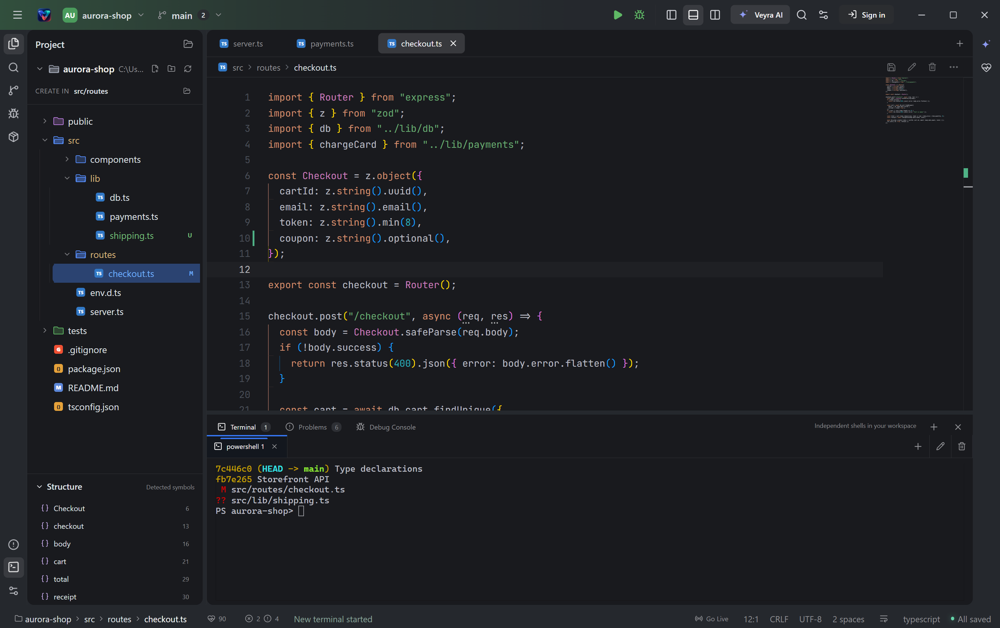
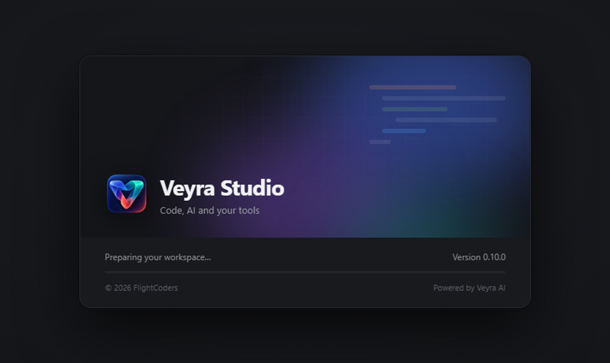
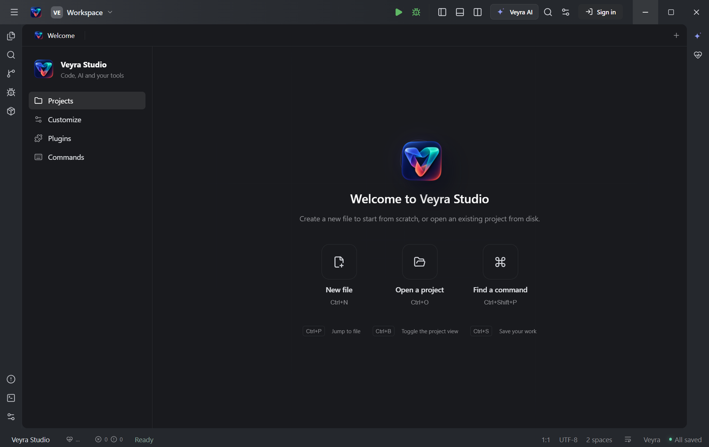
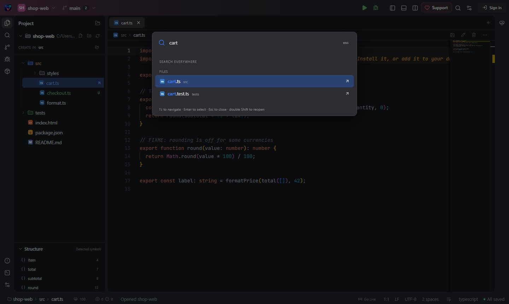
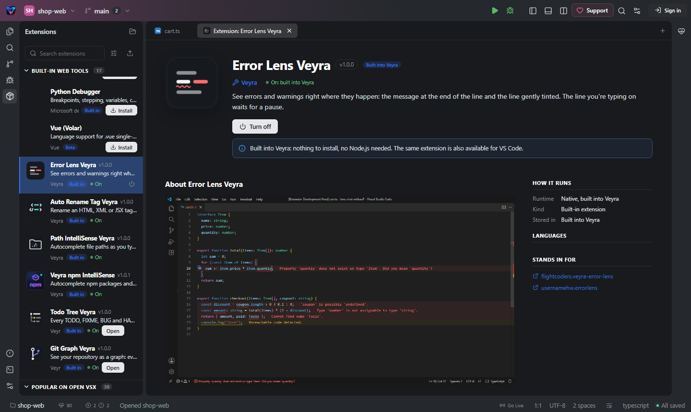
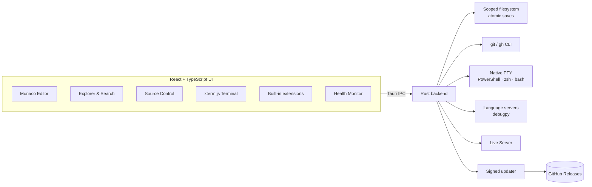

<div align="center">


# Veyra Studio

### A free, lightweight VS Code alternative: the same editor, a fraction of the weight.

[](https://veyraeditor.com)

Veyra Studio is an open-source **code editor for Windows, macOS and Linux** built on **Monaco** (the editor inside VS Code)
in a native **Rust + Tauri** app. Installers are **7–12 MB**, it starts fast, and Git, a real terminal, IntelliSense,
a Python debugger, Live Server and Android Studio-style navigation are built in. No AI, no telemetry, no account.

[](https://github.com/fcopensource/veyraeditor/releases/latest)
[](https://github.com/fcopensource/veyraeditor/actions/workflows/release.yml)
[](https://github.com/fcopensource/veyraeditor/releases)
[](#-download)
[](https://apps.microsoft.com/detail/XP8LKHC447THM1)
[](LICENSE)

[](https://tauri.app/)
[](https://www.rust-lang.org/)
[](https://microsoft.github.io/monaco-editor/)
[](https://react.dev/)
[](https://www.typescriptlang.org/)

**[⬇️ Download](#-download)** · [Website](https://veyraeditor.com) · [Veyra vs VS Code](#-veyra-vs-vs-code) · [What's new](#-whats-new-in-011) · [Features](#-features) · [Extensions](#-extensions-by-the-veyra-team) · [FAQ](#-faq) · [Build from source](#-build-from-source)

</div>

<br/>

<p align="center">
  
</p>

<table>
  <tr>
    <td width="50%" align="center"><br/><sub><b>The hummingbird</b> launch screen</sub></td>
    <td width="50%" align="center"><br/><sub><b>Recent Projects</b>: reopen any project in one click</sub></td>
  </tr>
  <tr>
    <td width="50%" align="center"><br/><sub><b>Search Everywhere</b>: tap Shift twice</sub></td>
    <td width="50%" align="center"><br/><sub><b>Extensions built in</b>: nothing to install</sub></td>
  </tr>
</table>

## 💡 Why Veyra?

- **Same editor as VS Code.** Monaco, IntelliSense, multi-cursor, the command palette and the shortcuts you already know.
- **Lighter on memory.** One small Rust process and the web view built into your OS: no bundled Chromium, no Node.js runtime, no extension host.
- **Small and quick.** Installers are 7–12 MB on Windows, macOS and Linux (`.deb`/`.rpm`). VS Code's are about 100 MB.
- **Everything included.** Git, a real terminal, Live Server, a Python debugger and popular extensions work out of the box.
- **Private.** No AI, no telemetry, no account needed. Your code never leaves your computer.

---

## 🆚 Veyra vs VS Code

Veyra is for developers who love VS Code's editor but not its weight.

| | **Veyra Studio** | VS Code |
| --- | --- | --- |
| **Built with** | Rust + the system web view (Tauri) | Electron (bundled Chromium + Node.js) |
| **Installer size** | 7–12 MB (the self-contained Linux AppImage is larger) | ~100 MB |
| **Memory** | Lighter: one Rust process plus the OS web view | Heavier: its own browser engine, plus window, GPU and extension-host processes |
| **Editor** | Monaco, the same engine | Monaco |
| **Shortcuts** | VS Code's, plus Android Studio's **Shift Shift** and **Ctrl+E** | VS Code's |
| **Built in** | Git, terminal, Live Server, Error Lens, Todo Tree, Git Graph, path & npm IntelliSense | Git and terminal; the rest are extensions |
| **AI** | None: a pure code editor | GitHub Copilot |
| **Telemetry** | None | On by default |
| **Price** | Free, MIT licensed | Free |

**Fair to know:** VS Code extensions that run their own code don't work in Veyra yet (themes and snippets from Open VSX do, and the most popular extensions are built in), and the debugger covers Python today. Both are on the [roadmap](#-roadmap). See the memory difference yourself: open the same project in both and compare them in Task Manager or Activity Monitor ([how](https://veyraeditor.com/blog/lightweight-vs-code-alternative-less-memory)).

---

## 🎉 What's new in 0.11

- 🐦 **A hummingbird launch screen** and a friendlier Welcome page.
- 📂 **Recent Projects** on the Welcome page: reopen any project in one click.
- 🔍 **Search Everywhere**: tap **Shift** twice to search files and actions in one place.
- 🕘 **Recent Files** with **Ctrl/⌘ + E**.
- ✅ **A TODO window** listing every TODO, FIXME and HACK comment, grouped by file.
- 🧩 **Popular extensions built in**: Error Lens, Auto Rename Tag, Path IntelliSense, npm IntelliSense, Todo Tree and Git Graph, with nothing to install.
- 🔒 **A pure code editor**: all AI features were removed. Your code never leaves your computer.

Full notes in the [changelog](CHANGELOG.md).

---

## 📥 Download

**[Download the latest release](https://github.com/fcopensource/veyraeditor/releases/latest)**, or get it from **[veyraeditor.com/download](https://veyraeditor.com/download)**.

| Platform | Installer | Notes |
| --- | --- | --- |
| **Windows** 10 / 11 | [Microsoft Store](https://apps.microsoft.com/detail/XP8LKHC447THM1) (recommended) · `Veyra.Studio_x.y.z_x64-setup.exe` · `.msi` | WebView2 is installed automatically if missing |
| **macOS** · Apple silicon | `Veyra.Studio_x.y.z_aarch64.dmg` | macOS 11 or newer |
| **macOS** · Intel | `Veyra.Studio_x.y.z_x64.dmg` | macOS 11 or newer |
| **Linux** | `.AppImage` (any distro) · `.deb` (Ubuntu/Debian) · `.rpm` (Fedora) | Requires WebKitGTK 4.1 |

**Veyra updates itself.** Installed copies check for new versions, verify the download's signature, and turn the top-right button into **Update** when one is ready.

> [!NOTE]
> The Microsoft Store version is signed and trusted by Windows. The GitHub installers are not yet signed by Microsoft or Apple. On **Windows**, SmartScreen may show *"Windows protected your PC"*: choose **More info → Run anyway**. On **macOS**, drag the app to Applications and open it once, then go to **System Settings → Privacy & Security → Open Anyway**.

---

## ✨ Features

| Area | What you get |
| --- | --- |
| **Editor** | Monaco (the editor behind VS Code): syntax highlighting for 80+ languages, multi-cursor, find & replace, formatting, sticky scroll, minimap |
| **Navigation** | Search Everywhere (**Shift Shift**), Recent Files (**Ctrl/⌘ + E**), Recent Projects, Quick Open, command palette, go to symbol and line |
| **Language tools** | One-click IntelliSense from the language servers VS Code uses: TypeScript/JavaScript, ESLint, Prettier, Tailwind CSS, Emmet, Svelte, Vue and **Python (Pyright)** |
| **Built-in extensions** | Error Lens, Auto Rename Tag, Path IntelliSense, npm IntelliSense, Todo Tree, Git Graph and Live Server, each switchable in Extensions |
| **Debugger** | Python debugging like VS Code: breakpoints, stepping, variables, watch, call stack and a Debug Console |
| **Explorer** | Real local folders, nested create, rename, copy/paste, duplicate, drag-and-drop, multi-select, move to Trash, reveal in Finder/File Explorer |
| **Terminal** | Real shells via a native PTY: PowerShell on Windows, your login shell on macOS/Linux. Multiple named sessions and "Run active file" |
| **Git** | Gutter markers, file-tree badges, side-by-side diffs, staging, commits, branches, sync, stash, history and a commit graph |
| **TODO window** | Every TODO, FIXME, HACK, XXX and BUG comment in the project, grouped by file and filterable by tag |
| **Health monitor** | A live 0–100 score with checks for responsiveness, memory, errors, Git and your toolchain, each with a fix |
| **Safe saving** | Atomic writes and protection against overwriting files changed elsewhere |
| **Extensions** | Open VSX marketplace with icons, ratings and a page per extension; themes and snippets install directly |
| **Customization** | A dark Islands theme inspired by Android Studio, a light theme, fonts, word wrap, minimap, resizable panels, split view |
| **Updates** | Signed automatic updates on every platform |

---

## 🧩 Extensions by the Veyra team

The team behind Veyra (FlightCoders) also makes free extensions for VS Code, Cursor and VSCodium. Several are built into Veyra Studio.

| Extension | What it does |
| --- | --- |
| [**Veyra Rewind**](https://marketplace.visualstudio.com/items?itemName=flightcoders.veyra-rewind) | Local history and time travel for every file; find code you deleted |
| [**Veyra Live Server**](https://marketplace.visualstudio.com/items?itemName=flightcoders.veyra-live-server) | Live reload on save; CSS updates without a reload |
| [**Error Lens Veyra**](https://marketplace.visualstudio.com/items?itemName=flightcoders.veyra-error-lens) | Errors and warnings at the end of their lines |
| [**Auto Rename Tag Veyra**](https://marketplace.visualstudio.com/items?itemName=flightcoders.veyra-auto-rename-tag) | Rename an HTML, XML or JSX tag and its pair follows |
| [**Pets Veyra**](https://marketplace.visualstudio.com/items?itemName=flightcoders.veyra-pets) | A cat, dog, fox, bunny or panda that lives in your editor |
| [**Veyra Container Studio**](https://marketplace.visualstudio.com/items?itemName=flightcoders.veyra-docker) | Docker containers, images, volumes and Compose |
| [**Veyra Query Lens**](https://marketplace.visualstudio.com/items?itemName=flightcoders.veyra-mongodb) | An index advisor for the MongoDB queries in your code |
| [**Git Graph Veyra**](https://marketplace.visualstudio.com/items?itemName=flightcoders.veyra-git-graph) | Your repository as a graph |
| [**Todo Tree Veyra**](https://marketplace.visualstudio.com/items?itemName=flightcoders.veyra-todo-tree) | Every TODO in your project, in one tree |
| [**Veyra Port Manager**](https://marketplace.visualstudio.com/items?itemName=flightcoders.veyra-port-manager) | See and free the ports your dev servers use |

See all of them at **[veyraeditor.com/extensions](https://veyraeditor.com/extensions)**.

---

## ⌨️ Keyboard shortcuts

Shortcuts follow your platform: **Ctrl** on Windows/Linux, **⌘** on macOS.

| Shortcut | Action |
| --- | --- |
| `Shift` `Shift` | Search Everywhere: files and actions |
| `Ctrl/⌘ + E` | Recent files |
| `Ctrl/⌘ + P` · `Ctrl/⌘ + Shift + P` | Quick Open · Command palette |
| `Ctrl/⌘ + O` · `Ctrl/⌘ + N` | Open folder · New file |
| `Ctrl/⌘ + S` · `Ctrl/⌘ + Shift + S` | Save · Save all |
| `Ctrl/⌘ + F` · `Ctrl/⌘ + Shift + F` | Find in file · Search workspace |
| `Ctrl/⌘ + D` · `Ctrl/⌘ + Shift + L` | Add next occurrence · Select all occurrences |
| `F12` · `Shift + F12` · `Ctrl + G` | Go to definition · References · Line |
| `Ctrl/⌘ + B` | Toggle sidebar |
| ``Ctrl + ` `` · ``Ctrl + Shift + ` `` | Terminal · New terminal |
| `F5` · `Shift + F5` · `F9` · `F10` · `F11` | Debug · Stop · Breakpoint · Step over · Step into |
| `Alt + L` `Alt + O` | Open with Live Server |
| `Ctrl/⌘ + ,` | Settings |

---

## ❓ FAQ

**Is Veyra Studio free?**
Yes. It's free and open source under the MIT license, with no account, no paid tier and no telemetry.

**Is Veyra a VS Code fork?**
No. Veyra uses Monaco, the editor component inside VS Code, in its own native app built with Rust and Tauri. That's why it's so much smaller.

**Can I use my VS Code extensions?**
Themes and snippets from Open VSX install directly, and the most popular extensions (ESLint, Prettier, Tailwind, Live Server, Error Lens, Todo Tree, Git Graph and more) are built in. Extensions that run their own code need an extension host, which is on the roadmap.

**Does Veyra have AI?**
No. Since version 0.11 Veyra is a pure code editor: your code never leaves your computer.

**Which languages does it support?**
Syntax highlighting for 80+ languages, and full IntelliSense for JavaScript, TypeScript, HTML, CSS, Tailwind, Vue, Svelte and Python.

**How do I move from VS Code?**
Your shortcuts already work. See [moving from VS Code](https://veyraeditor.com/blog/moving-from-vs-code).

---

## 🛠 Build from source

**Prerequisites:** [Node.js 22+](https://nodejs.org), [Rust (stable)](https://rustup.rs), Git, and the [Tauri system dependencies](https://tauri.app/start/prerequisites/) for your OS: WebView2 (preinstalled on Windows 11), Xcode Command Line Tools on macOS, WebKitGTK 4.1 on Linux.

```bash
git clone https://github.com/fcopensource/veyraeditor.git
cd veyraeditor
npm ci
npm run tauri dev       # the desktop app with native filesystem, Git and terminal
```

The first Rust build compiles about 450 crates and takes a few minutes; after that, launches take seconds. `npm run dev` starts only the web UI, so native features won't work there.

> [!TIP]
> If the first build runs out of memory (common with 8–16 GB of RAM), compile one crate at a time:
> `CARGO_BUILD_JOBS=1 npm run tauri dev` (PowerShell: `$env:CARGO_BUILD_JOBS=1; npm run tauri dev`).

**Production installers** for your own OS: `npm run tauri build` (output in `src-tauri/target/release/bundle/`). Official multi-platform releases are built by GitHub Actions: see **[docs/RELEASING.md](docs/RELEASING.md)**.

---

## 🏗 Architecture



**Stack:** Tauri 2 · Rust · React 19 · TypeScript · Monaco · xterm.js · portable-pty · Vite · Playwright

```text
veyraeditor/
├── src/                     React UI
│   ├── App.tsx              Workbench: explorer, tabs, editor, panels, status bar
│   ├── CommandPalette.tsx   Search Everywhere, Recent Files, commands, symbols
│   ├── features/            Built-in extensions: Error Lens, Auto Rename Tag, Path & npm IntelliSense
│   ├── TodoPanel.tsx        The TODO window
│   ├── ExtensionsPanel.tsx  Marketplace and built-in tools   (lsp/: language clients)
│   ├── DebugPanel.tsx       Run and Debug   (debug/: DAP client, breakpoints)
│   ├── SourceControl.tsx    Git panel
│   └── Terminal.tsx         xterm.js terminal sessions
├── src-tauri/src/           Rust backend
│   ├── lib.rs               Filesystem, search, Git, terminal, menus
│   ├── lsp.rs · dap.rs      Language servers and the Python debugger
│   ├── live_server.rs       Live Server: static server, file watching, live reload
│   ├── account.rs           Optional veyraeditor.com sign-in
│   └── health.rs            Native health checks
├── extensions/              The Veyra team's VS Code extensions
├── website/                 veyraeditor.com (Next.js)
├── .github/workflows/       Checks, releases and extension publishing
└── tests/                   Playwright UI tests (mocked native IPC)
```

---

## 🧪 Testing

```bash
npm run build                       # type-check + production frontend build
npx playwright install chromium     # once
npx playwright test                 # UI regression suite
cd src-tauri && cargo test --lib    # native unit tests
```

The Playwright suite drives the real UI against mocked native IPC: editing, saving, the explorer, search, Git, the built-in extensions, Search Everywhere and the TODO window. Rust tests cover path-traversal and symlink protection, save conflicts, search rules and Git safety. Every extension is also tested inside real VS Code on each change.

---

## 🔐 Privacy & security

- **Local only:** no AI and no telemetry. File operations are scoped to the folder you open, and symbolic links that escape the workspace are rejected.
- **Safe writes:** atomic saves; Veyra refuses to overwrite a file that changed on disk and keeps your edits.
- **Signed updates:** every update is verified against the public key built into the app before it's installed.
- **Terminal:** shells run with your normal user permissions. Only run commands you trust.

Found a security issue? See [veyraeditor.com/security](https://veyraeditor.com/security).

---

## 🗺 Roadmap

**Shipped**
- [x] Monaco editor, explorer, tabs, workspace search, command palette
- [x] Search Everywhere, Recent Files, Recent Projects and a TODO window
- [x] Real multi-session terminal (PowerShell / zsh / bash)
- [x] Full Git workflow: gutter markers, diffs, staging, commits, branches, sync, stash, graph
- [x] Language servers: TypeScript, ESLint, Prettier, Tailwind, Emmet, Svelte, Vue, Python
- [x] Python debugger: breakpoints, stepping, variables, watch, Debug Console
- [x] Built-in Error Lens, Auto Rename Tag, Path & npm IntelliSense, Todo Tree, Git Graph, Live Server
- [x] Windows, macOS and Linux installers with signed auto-updates, and the Microsoft Store

**Next**
- [ ] Node.js / TypeScript debugging
- [ ] Rust, Go and C/C++ language servers
- [ ] More of the Veyra team's extensions built in
- [ ] Code-signed Windows and notarized macOS builds

---

## 🤝 Contributing

Contributions are welcome: fork the repository, create a focused branch, run the relevant tests and open a pull request with a clear explanation. Screenshots help a lot for UI changes; regression tests are especially valuable for filesystem behaviour. Please never commit credentials, signing keys, private data, dependency folders or build artifacts.

## 💼 Need something built?

Veyra is made by **[FlightCoders](https://veyraeditor.com/flightcoders)**. We build VS Code and JetBrains extensions, desktop apps, browser extensions, web apps and Salesforce solutions. **[Tell us about your project →](https://veyraeditor.com/flightcoders#start)**

## 📄 License

Veyra Studio is released under the [MIT License](LICENSE). Copyright © 2026 Vikram Singh.

<div align="center">

---

**Your code. Your machine. Nothing else.**

If Veyra is useful to you, please give the repository a ⭐: it helps other developers find it.

[Back to top](#veyra-studio)

</div>
