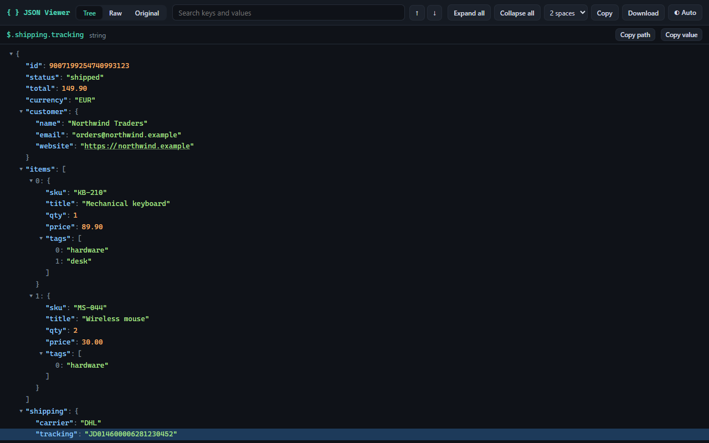

# JSON Viewer Veyra (Chrome extension)

Open any JSON in Chrome and read it as a clear, searchable tree.



## What it does

- **A tree you can read.** Open and close any level, with a count of keys and items. Small files open fully, big ones open the top level and show 200 items at a time, so a 10 MB response stays fast.
- **Exact numbers.** Long IDs like `9007199254740993123` and prices like `19.90` are shown exactly as the server sent them. Most viewers round them silently.
- **The path of every value.** Click a value to see `$.items[0].price`, and copy the path or the value.
- **Search.** Keys and values, with Enter and Shift+Enter to step through matches. Ctrl+F jumps to the search box.
- **Mistakes, explained.** Broken JSON shows the line and column, highlights the line, and says plainly what's wrong, like an extra comma before `}`.
- **Raw and Original views.** Formatted and coloured with 2 spaces, 4 spaces, tabs or one line, or the text exactly as the page sent it.
- **Copy and download.** The whole JSON or the selected value.
- **Paste or open a file.** Click the toolbar button to paste JSON or open a `.json` file.
- **Dark, light or automatic** theme. Your view, indent and theme are remembered.

## Private and safe

- Nothing is sent anywhere. No analytics, no account, no network requests.
- The page's data is only ever shown as text: a JSON document can't run code through the viewer, and only `http` and `https` links are made clickable.
- It only changes pages that are JSON (a JSON content type, or plain text that is JSON). Web pages are never touched.
- The only permission is `storage`, to remember your view, indent and theme.

## Develop

```console
npm test                 # the core: parsing, exact numbers, paths, search, error positions
npm run test:browser     # loads the extension into Chromium with Playwright and checks real pages
npm run zip              # release/json-viewer-veyra-<version>.zip for the Chrome Web Store
node scripts/screenshots.mjs   # store/ screenshots and the promo tile
```

To try it: open `chrome://extensions`, turn on **Developer mode**, click **Load unpacked** and pick this folder.

Made by [FlightCoders](https://flightcoders.com), the team behind the [Veyra](https://veyraeditor.com) editor. MIT licensed.
