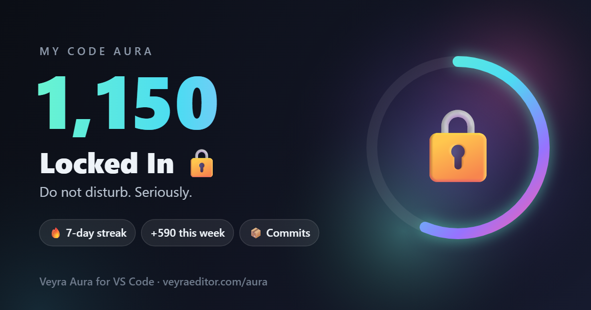
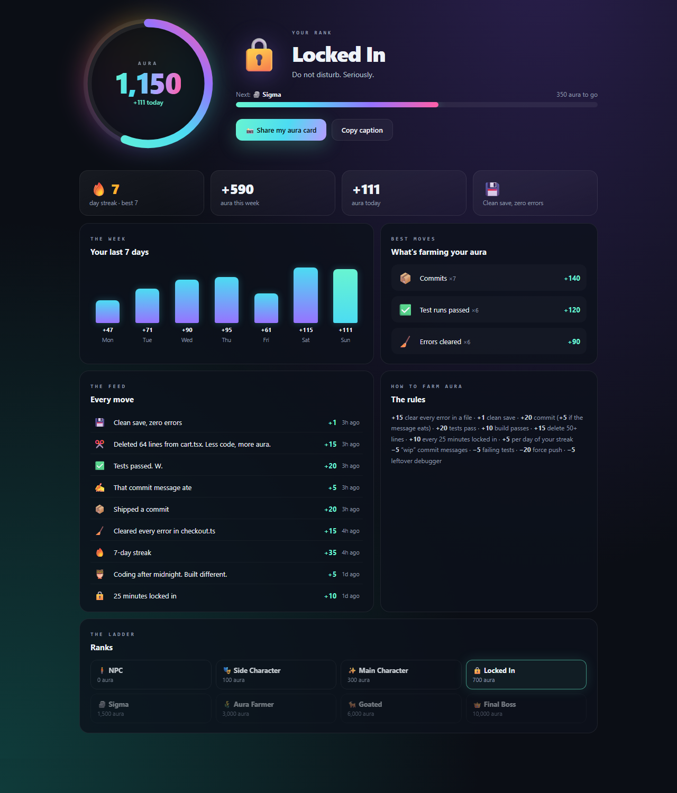

  

# Veyra Aura ✨

**Your coding aura. Farm it, flex it, share it.**

Every time you clear your errors, ship a commit or get your tests green, your aura goes up. Leave a `wip` commit message or force-push to main? That's a minus 💀. Rank up from **NPC** to **Final Boss**, keep your **🔥 streak** alive, and share your **aura card**. Free and 100% local. By the makers of [Veyra Studio](https://veyraeditor.com).

## How to farm aura

| Move | Aura |
| --- | --- |
| 🧹 Clear every error in a file | **+15** |
| 💾 Save a file with zero errors | **+1** |
| 📦 Ship a commit | **+20** |
| ✍️ …with a commit message that eats (`feat: add dark mode toggle`) | **+5** |
| ✅ Tests pass (`npm test`, `pytest`, `go test`, `cargo test`…) | **+20** |
| 🏗️ Build passes | **+10** |
| ✂️ Delete 50+ lines in one go | **+15** |
| 🔒 Every 25 minutes locked in | **+10** |
| 🔥 Each day of your streak | **+5** per day (up to +50) |
| 🦉 Coding after midnight | **+5** |

### Roast mode 💀 (on by default, turn it off any time)

| Move | Aura |
| --- | --- |
| A commit message that says nothing (`wip`, `fix`, `asdf`, `.`) | **−5** |
| Tests said nah | **−5** |
| Build fumbled | **−3** |
| `git push --force` (`--force-with-lease` is fine) | **−20** |
| A `debugger` statement left in a saved file | **−5** |

There are daily limits on every move, so you can't farm aura by saving the same file 500 times. Nice try.

## The ranks

🧍 **NPC** (0) → 🎭 **Side Character** (100) → ✨ **Main Character** (300) → 🔒 **Locked In** (700) → 🗿 **Sigma** (1,500) → 🌾 **Aura Farmer** (3,000) → 🐐 **Goated** (6,000) → 👑 **Final Boss** (10,000)

Go below zero and you're ☠️ **Negative Aura**. It can only go up from there.

## Your aura, at a glance

- Your aura and streak live in the **status bar**, and each move flashes there as it happens: `+15 aura 🧹`.
- Click it (or run **Aura: Show My Aura**) for the full panel: your rank, progress to the next one, your week, your best moves, and every move in a feed.
- A notification when you **rank up**.

## Share your aura card 📸

Click **Share my aura card** (or run **Aura: Share My Aura Card**). You get a 1200 × 630 image, the size X, LinkedIn and Instagram previews love, and a caption copied and ready to paste:

> My code aura: 1,150 (Locked In 🔒) · 🔥 7-day streak · +590 this week. Built different. #VeyraAura #coding

## How it knows

Aura only uses what VS Code already sees, on your computer:

- **Errors** from VS Code's Problems (any language).
- **Saves and edits** in the editor.
- **Commits** from VS Code's built-in Git, however you make them: the Source Control view, the terminal or another tool.
- **Tests and builds** from VS Code tasks, and from terminal commands when shell integration is on (VS Code 1.93 and newer).

Nothing is sent anywhere: your aura is stored in VS Code on your computer. No account, no leaderboard you didn't ask for, no telemetry.

## Settings

| Setting | Default | |
| --- | --- | --- |
| `veyraAura.enabled` | `true` | Earn aura while you code. |
| `veyraAura.roast` | `true` | Roast mode: lose a little aura for the moves above. Off means you only ever gain. |
| `veyraAura.notifications` | `rankUps` | `rankUps`, `all` (every move worth 10+), or `off`. |
| `veyraAura.statusBar` | `true` | Show your aura and streak in the status bar. |

**Aura: Reset My Aura** starts you over at 0, if you want a fresh arc.

## More from Veyra

Veyra Aura is part of a family of free, local-first tools by the makers of [Veyra Studio](https://veyraeditor.com), the lightweight VS Code alternative: [Veyra Live Values](https://veyraeditor.com/live-values), [Veyra Hotspots](https://veyraeditor.com/hotspots), [Code Garden Veyra](https://veyraeditor.com/garden) and [more](https://veyraeditor.com/extensions).

Found a bug or have an idea for a new move? [Open an issue](https://github.com/fcopensource/veyraeditor/issues).
