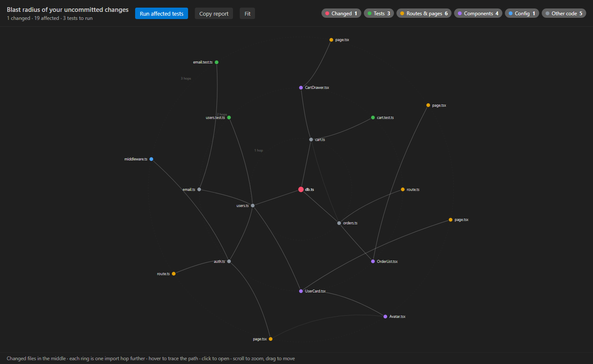
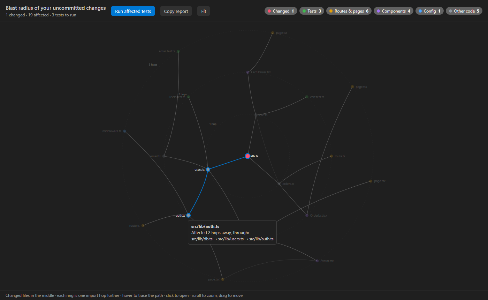

  

# Veyra Blast Radius

**Know what your change can break, before you commit.**

You changed one file. What else did you just change? Veyra Blast Radius follows every import in your project, backwards, and shows you every file, page, API route, component and test that depends on what you edited. Then it runs only the tests that matter. **Free, 100% local, nothing to configure.** By the makers of [Veyra Studio](https://veyraeditor.com).

- 💥 **See the blast radius of your uncommitted changes,** right next to your commit box in Source Control, with a count on the view.
- 🧭 **Grouped the way you think:** Tests to run, Routes, pages & APIs, Components, Config & middleware, and Other code.
- 🕸️ **A graph you can explore:** your changes in the middle, every ring one import further. Hover a file to trace exactly how your change reaches it.
- 🧪 **Run only the affected tests** in one click, with Vitest, Jest, Mocha, Playwright, `node --test` or pytest.
- 🔎 **"Used by 7 files · blast radius 23"** at the top of every file, before you even touch it.
- 📋 **Copy an impact report** in Markdown, ready for your pull request.
- 🗑️ **Deleted a file?** Blast Radius still shows every file that imported it, because those are the ones that break.

---

## How it works

Blast Radius reads the imports in your project, the same way your bundler would, and builds a map of who imports whom. When you change a file, it walks that map **backwards**: everything that imports your file, everything that imports those, and so on. That's your blast radius.

It understands:

| | |
| --- | --- |
| **JavaScript & TypeScript** | `import`, `export … from`, `require()`, dynamic `import()`, `import type`; `.ts`, `.tsx`, `.js`, `.jsx`, `.mjs`, `.cjs` |
| **Frameworks** | Vue, Svelte and Astro components; Next.js, Nuxt, SvelteKit and Remix routes |
| **Path aliases** | `@/components/…`, `~/lib/…` and every other `paths` / `baseUrl` from `tsconfig.json` or `jsconfig.json`, including several in a monorepo |
| **ESM TypeScript** | `import "./util.js"` that really means `util.ts` |
| **Python** | `import a.b`, `from a.b import c`, relative `from ..core import db`, packages with `__init__.py` |

Packages from `node_modules` and the standard library are outside your project, so they're not followed. Imports inside comments don't count.

## Where to find it

| | |
| --- | --- |
| **Source Control → Blast Radius** | The blast radius of your uncommitted changes (staged, unstaged and new files) |
| **The status bar** | `🔥 23 affected · 🧪 3`: click it to open the view |
| **The top of every file** | `Used by 7 files · blast radius 23`: click it to see them |
| **Right-click a file** | In the Explorer or on an editor tab: **Show Blast Radius of This File** |

The buttons at the top of the view:

| | |
| --- | --- |
| **Run Affected Tests** | Runs the tests in the blast radius in a terminal |
| **Show Graph** | Opens the graph beside your code |
| **Show Current File / Show Uncommitted Changes** | Switch between the open file and your git changes |
| **Refresh** | Read the project's imports again |
| **⋯ → Copy Impact Report** | A Markdown summary for your pull request |

Right-click a file in the view and choose **Why Is This Affected?** to see the chain of imports, one file at a time.

## Trace the path

Hover any file in the graph and the path from your change lights up, with the reason spelled out: *"Affected 2 hops away, through `src/lib/db.ts → src/lib/users.ts → src/lib/auth.ts`"*. Click it to open the file. Scroll to zoom, drag to move.

## Settings

| Setting | Default | |
| --- | --- | --- |
| `veyraBlast.maxDepth` | `8` | How many import hops to follow |
| `veyraBlast.testCommand` | (detected) | Your own test command, for example `pnpm vitest run ${files}` |
| `veyraBlast.exclude` | `node_modules`, `dist`, `build`, `.next`, `venv`… | Folders and files to leave out |
| `veyraBlast.codeLens` | `true` | "Used by N files" at the top of each file |
| `veyraBlast.statusBar` | `true` | The count in the status bar |
| `veyraBlast.maxFiles` | `20000` | The most source files to read in a very large project |

## Private and light

Everything happens on your computer. Blast Radius reads your files and runs `git status`, and that's all: no account, no telemetry, nothing sent anywhere. It reads only the import lines, so even a project with thousands of files is mapped in seconds, and the map is updated as you save.

In Restricted Mode it shows the blast radius of the open file, but doesn't run git or tests.

## More from Veyra

Veyra Blast Radius is part of a family of free extensions from [Veyra Studio](https://veyraeditor.com), a lightweight code editor. See them all at **[veyraeditor.com/extensions](https://veyraeditor.com/extensions)**.

## License

[MIT](LICENSE) © Flight Coders
