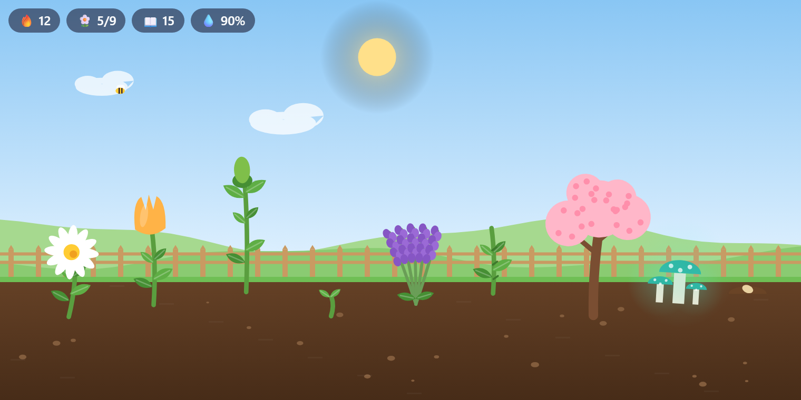
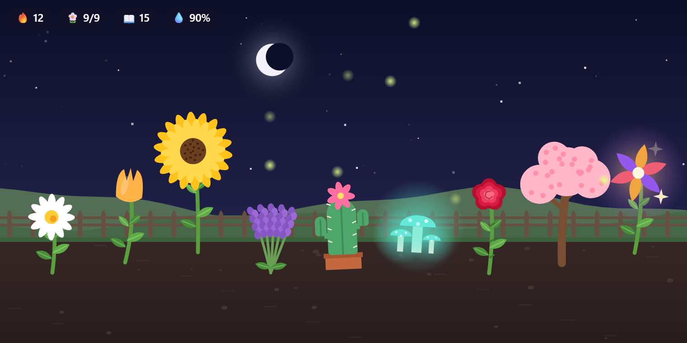
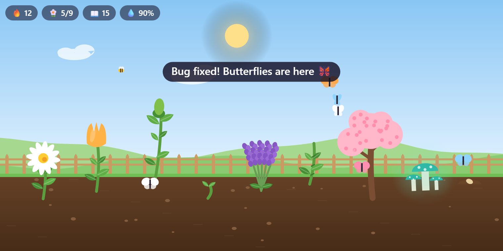
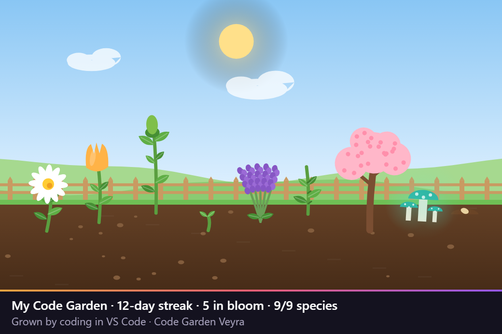

  

# Code Garden Veyra

**Your coding grows a garden.**

Code Garden puts a little garden in VS Code that grows while you work. Every minute of coding helps your plants grow, **saving waters them**, **fixing your last error brings butterflies**, and **every commit makes a flower burst into bloom**. Code a few days in a row and rare plants unlock. **Free, offline, and drawn from scratch.** By the makers of [Veyra Studio](https://veyraeditor.com).

- 🌱 **It grows while you code:** seed, sprout, leaves, bud and bloom. A new seed sprouts every 20 minutes of coding.
- 💧 **Saving waters it:** watered soil grows plants at full speed. Leave it for a day and the soil dries and the plants droop, but **nothing ever dies**. One save and it rains.
- 🦋 **Fix the last error, get butterflies:** clear all your errors and butterflies flutter in, and every plant gets a boost.
- 🌸 **Commit, and something blooms:** each commit makes your most grown plant burst into flower.
- 🔥 **Streaks unlock rare plants:** nine species to collect, from the daisy to the golden **Veyra Bloom**.
- 🌙 **Day and night follow your clock:** sunrise, clouds and bees by day; stars, fireflies and glowing mushrooms at night.
- 📸 **Share it:** save a picture of your garden with your streak, ready for X, LinkedIn or your team chat.

---

## At night

## Fix the last error, and the butterflies come

## Collect all nine

| Plant | How to unlock it |
| --- | --- |
| 🌼 **Daisy** | Your first flower |
| 🌷 **Tulip** | Code on 2 days in a row |
| 🌻 **Sunflower** | Code for 3 hours in total |
| 💜 **Lavender** | Save 100 times |
| 🌵 **Cactus** | Fix 10 errors (it thrives on trouble) |
| 🍄 **Glow Mushroom** | Code for an hour after 10 pm |
| 🌹 **Rose** | Make 15 commits |
| 🌸 **Cherry Blossom** | Code on 7 days in a row |
| ✨ **Veyra Bloom** | Code on 30 days in a row, or press 40 flowers |

When your garden is full (12 plants), the oldest flower that has been in bloom for a while is **pressed into your collection** to make room for a new seed. **Show My Collection** lists every species, what you've unlocked and how many you've pressed.

New plants are a surprise, but once a species is unlocked you can pick it: **Choose the Next Seed…**

## Share your garden

**Save a Snapshot to Share…** (the camera button on the view) saves a picture of your garden with your streak and collection underneath.

## Where to find it

- **In the Explorer:** the **Code Garden** view at the bottom of the Explorer. Drag it up for more room.
- **In a bigger panel:** **⋯ → Open in a Bigger Panel**.
- **In the status bar:** 🔥 your streak and ❤ the flowers in bloom. Hover for the details, click to open the garden.
- Hover over a plant to see its name, its stage and how close it is to blooming.

## Commands

| Command | What it does |
| --- | --- |
| **Code Garden: Show My Collection** | Every species, what's unlocked, what you've grown and pressed, and your totals |
| **Code Garden: Choose the Next Seed…** | Pick the species of the next sprout, from the ones you've unlocked |
| **Code Garden: Save a Snapshot to Share…** | Save a PNG of your garden with a caption |
| **Code Garden: Open in a Bigger Panel** | The garden in an editor tab |
| **Code Garden: Start a New Garden…** | Clear everything and start again (asks first) |

## Settings

| Setting | Default | What it does |
| --- | --- | --- |
| `veyraGarden.sky` | `auto` | `auto` follows your clock; `day` or `night` keeps it that way |
| `veyraGarden.statusBar` | `true` | Show your streak and blooms in the status bar |
| `veyraGarden.notifications` | `true` | Tell you when a plant is unlocked or your streak reaches a milestone |

## How it counts

- **A coding minute** is a minute in which you typed in a file while VS Code was focused. Reading and idle time don't count, and neither does typing in the terminal or Output.
- **Saves** count once every couple of seconds at most, so Save All or auto-save don't flood the garden.
- **Fixes** count when the number of errors drops to zero.
- **Commits** come from VS Code's built-in Git extension. If Git is turned off, the garden still grows; you just miss the commit blooms.
- **The streak** counts calendar days (in your time zone) with at least one coding minute.

## Private by design

Code Garden never reads your code and never sends anything anywhere. It only counts minutes, saves, errors and commits. Your garden is kept in VS Code's own storage and follows you between machines with Settings Sync.

## More from Veyra

[Pets Veyra](https://veyraeditor.com/pets) · [Veyra Wrapped](https://veyraeditor.com/wrapped) · [Veyra Rewind](https://veyraeditor.com/rewind) · [Error Lens Veyra](https://veyraeditor.com/error-lens) · [All Veyra extensions](https://veyraeditor.com/extensions)

Or try **[Veyra Studio](https://veyraeditor.com)**, the lightweight VS Code alternative.
