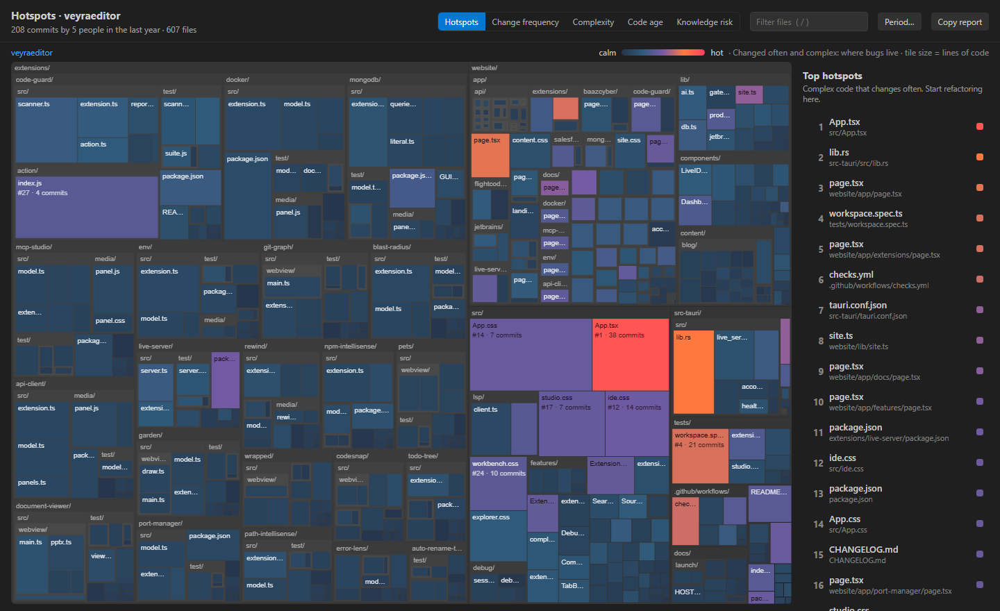
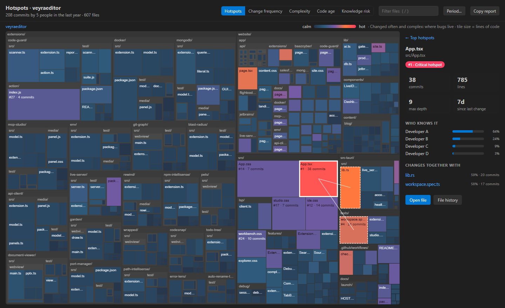
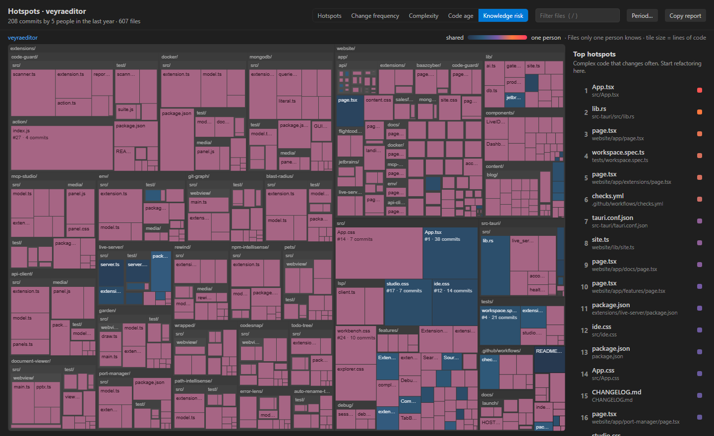

  

# Veyra Hotspots

**A living heat map of your codebase. Find the files where bugs live.**

Some files cause most of the trouble: they're complicated **and** they change all the time. Veyra Hotspots reads your project's own git history, finds those files, and shows your whole codebase as one heat map. It also shows who knows each file, which files secretly change together, and the code only one person understands. **Free, 100% local, nothing to configure.** By the makers of [Veyra Studio](https://veyraeditor.com).

- 🔥 **The hotspot map:** every file is a tile, sized by its code and coloured by risk. Zoom into any folder.
- 🏆 **Top hotspots, ranked:** the files to refactor first, with the reason spelled out.
- 🔗 **Files that change together:** pairs that keep landing in the same commits, often across folders. A hidden dependency, made visible.
- 👤 **Knowledge risks:** files only one person has changed, and code whose only author has left.
- 🧭 **Five ways to look:** Hotspots, Change frequency, Complexity, Code age and Knowledge risk.
- 🚩 **Flames in the Explorer** on the hottest files, and the open file's rank in the status bar.
- 📋 **Copy a report** for a planning meeting, an issue or a pull request.

---

## Why hotspots?

Studies of real codebases keep finding the same thing: a small share of the files attract most of the bugs and most of the work. They are the files that are **complex** (deeply nested, long) and **changed often**. Either one on its own is fine: complex code nobody touches is stable, and simple code that changes a lot is easy. Together they're where mistakes happen.

Veyra Hotspots scores every file on both, from your git history and the code as it is today, so you know where refactoring pays off most.

## The map

- **Hover** a tile to see its commits, size, depth, last change and main author.
- **Click** a file for the full story: who knows it, how deep it's nested, and the files that change with it, linked by dashed lines on the map.
- **Double-click** to open it. **Click a folder's name** to zoom in, and use the breadcrumb or <kbd>Esc</kbd> to zoom out.
- **Type** to filter (<kbd>/</kbd> jumps to the filter box).

Open it from the **Hotspots** icon in the activity bar, or run **Hotspots: Show Hotspot Map**.

## Five colour modes

| Mode | Hot means |
| --- | --- |
| **Hotspots** | Complex *and* changed often: refactor these first |
| **Change frequency** | Touched by many commits |
| **Complexity** | Deeply nested code |
| **Code age** | Not changed for a long time |
| **Knowledge risk** | Only one person has changed it, or its only author has left |

## In the sidebar

| | |
| --- | --- |
| **Top Hotspots** | The 50 hottest files, ranked. Hover for why |
| **Changes Together** | Pairs of files that change in the same commits, with how often |
| **Knowledge Risks** | Files whose only author has left, then files only one person has changed |

Right-click a file for **Why Is This a Hotspot?**, **Show in Hotspot Map**, **Open Files That Change With This One** and **File History** (its recent commits, each one's diff a click away).

## How it's measured

- **Change frequency:** the commits that touched the file in the period you choose (the last year by default), merges excluded.
- **Complexity:** the file's lines of code and how deeply they're indented. Indentation follows nesting (ifs in loops in callbacks) in every language, so it works the same for TypeScript, Python, Go, Rust, C#, Java and the rest.
- **Hotspot score:** change frequency × complexity, each on a log scale so one giant file doesn't flatten the rest.
- **Changes together:** two files that shared at least 4 commits, together at least 40% of the time. Huge commits (formatting runs, mass renames) are ignored.
- **Knowledge:** who changed the most lines. "Has left" means no commits for 6 months.

Lock files, build output, `node_modules`, minified files, snapshots and migrations are left out. Change that with `veyraHotspots.exclude`.

## Settings

| Setting | Default | |
| --- | --- | --- |
| `veyraHotspots.months` | `12` | How much history to read: 1, 3, 6, 12, 24 months, or 0 for all |
| `veyraHotspots.explorerBadges` | `true` | Flames on the hottest files in the Explorer |
| `veyraHotspots.explorerTop` | `10` | How many files get a flame |
| `veyraHotspots.statusBar` | `true` | The open file's rank in the status bar |
| `veyraHotspots.exclude` | lock files, build output… | Files to leave out |
| `veyraHotspots.maxCommits` | `20000` | The most commits to read |

## Private

Everything happens on your computer. Hotspots runs `git log` and reads your files, and that's all: no account, no telemetry, nothing sent anywhere. It needs a trusted folder, because it runs git.

## More from Veyra

Veyra Hotspots is part of a family of free extensions from [Veyra Studio](https://veyraeditor.com), a lightweight code editor. Pairs well with [Veyra Blast Radius](https://veyraeditor.com/blast-radius), which shows what a change can break before you commit. See them all at **[veyraeditor.com/extensions](https://veyraeditor.com/extensions)**.

## License

[MIT](LICENSE) © Flight Coders
