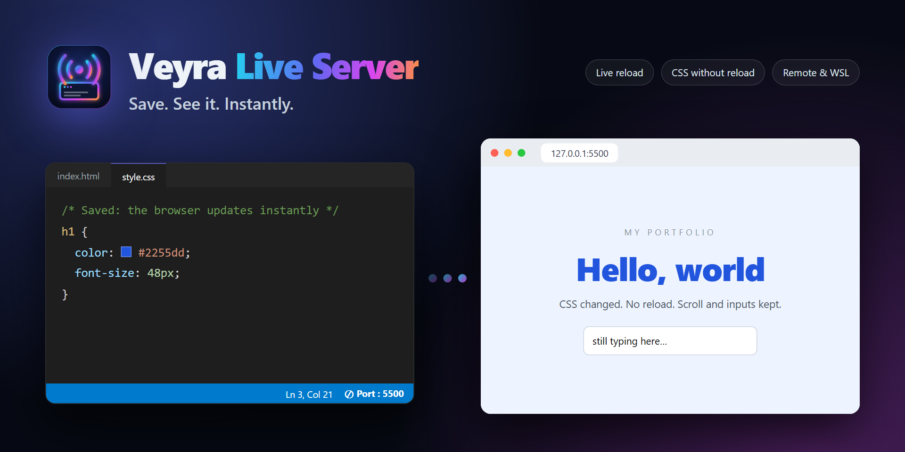
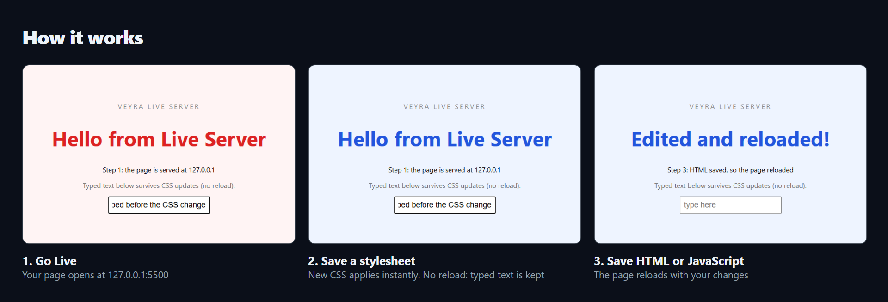

  

# Veyra Live Server

**Save. See it. Instantly.** A local development server with live reload for HTML, CSS and JavaScript.

- 🔁 **Live reload.** Save an HTML or JavaScript file and every open tab reloads on its own.
- 🎨 **CSS without a reload.** Save a stylesheet and the new styles are swapped in place. Scroll position, open menus and text you typed into forms stay exactly where they were.
- 🚀 **Go Live in one click.** From the status bar, the button on HTML editor tabs, or right-click any HTML file → **Open with Live Server**.
- ↕️ **Keeps your place.** After a reload the page comes back at the same scroll position, so you never have to scroll down to what you were working on again.
- 🖥️ **The browser console in VS Code.** `console.log`, warnings, errors and unhandled promise rejections from the page appear in the **Browser Console** output, with an error count in the status bar.
- 📱 **Test on your phone.** Turn on **Share on Your Network** and open the page on any phone or tablet on the same Wi-Fi. It's off until you ask.
- 🔀 **API proxy.** Send `/api/…` to your backend (`http://localhost:3000` and friends), so your page can call it without CORS headaches.
- 🧭 **Single-page apps.** React Router, Vue Router and friends: routes like `/about` get your `index.html` instead of a 404.
- 🎬 **Media friendly.** Videos and audio stream and seek smoothly.
- 🌍 **Works remotely.** Remote SSH, WSL, Dev Containers and GitHub Codespaces: the page opens in your local browser through VS Code's port forwarding.
- ⚡ **Only reloads when it matters.** Changes outside the served folder (a `src` folder next to `dist`, build logs…) don't reload the page, and you can ignore more with `veyraLiveServer.ignore`.
- 🔒 **Private by design.** Listens on `127.0.0.1` only (unless you choose to share it) and never serves files outside your folder.
- 🪶 **Tiny.** No runtime dependencies and no telemetry.

## How it works

  

1. Open a folder with an `index.html` (or any HTML file).
2. Click **Go Live** in the status bar. Your page opens at `http://127.0.0.1:5500`, and the status bar shows the port.
3. Edit and save. CSS updates in place; HTML and JavaScript reload the page.
4. Click the port in the status bar for **Open in Browser**, **Copy Address**, **Browser Console**, **Share on Your Network**, **Restart** or **Stop**.

Folders without an `index.html` show a clean list of their files.

## Commands and shortcuts

| Command | Windows / Linux | macOS |
| --- | --- | --- |
| **Veyra Live Server: Open with Live Server** | <kbd>Alt</kbd>+<kbd>L</kbd> <kbd>Alt</kbd>+<kbd>O</kbd> | <kbd>⌘</kbd>+<kbd>L</kbd> <kbd>⌘</kbd>+<kbd>O</kbd> |
| **Veyra Live Server: Stop Live Server** | <kbd>Alt</kbd>+<kbd>L</kbd> <kbd>Alt</kbd>+<kbd>C</kbd> | <kbd>⌘</kbd>+<kbd>L</kbd> <kbd>⌘</kbd>+<kbd>C</kbd> |
| **Veyra Live Server: Open in Browser** · **Copy Address** · **Restart Live Server** · **Show Browser Console** · **Copy Network Address** | Command Palette, while running | Command Palette, while running |
| **Veyra Live Server: Share on Your Network (Test on Your Phone)** | Command Palette | Command Palette |

The same shortcuts as the classic Live Server extension, so your fingers already know them.

## Settings

| Setting | Default | What it does |
| --- | --- | --- |
| `veyraLiveServer.port` | `5500` | Port to serve on. If it's busy, the next free port is used. `0` picks any free port. |
| `veyraLiveServer.root` | `""` | Subfolder to serve, such as `/public` or `/dist`. Changing it (or the port) restarts Live Server. |
| `veyraLiveServer.openBrowser` | `true` | Open the page in your default browser when Live Server starts. |
| `veyraLiveServer.browserConsole` | `true` | Show the page's console messages and errors in the **Veyra Live Server: Browser Console** output. |
| `veyraLiveServer.shareOnNetwork` | `false` | Also serve on your local network, to open the page on a phone or tablet. |
| `veyraLiveServer.proxy` | `{}` | Forward paths to another server, for example `{ "/api": "http://localhost:3000" }`: `/api/users` goes to `http://localhost:3000/api/users`. |
| `veyraLiveServer.spa` | `false` | Single-page apps: paths that aren't files get the root `index.html`. |
| `veyraLiveServer.ignore` | `[]` | Patterns whose changes don't reload the page, such as `["**/*.log", "drafts/**"]`. |

Changing any of these restarts Live Server, so they take effect right away.

### Test on your phone

1. Click the port in the status bar → **Share on Your Network…** (the first time, Live Server asks you to confirm).
2. Open the address it shows (like `http://192.168.1.20:5500/`) on your phone, on the same Wi-Fi.
3. The phone reloads with every save too. Its console messages appear in the **Browser Console** output, which makes mobile bugs easy to find.

If the phone can't connect, allow VS Code through your computer's firewall for private networks.

## Privacy and security

- The server accepts connections from **your computer only** (`127.0.0.1`), unless you turn on **Share on Your Network**. Then devices on your network can open the served folder while Live Server runs; use it on networks you trust.
- Only files **inside the served folder** are sent. Requests that try to leave it (`../`, encoded slashes, symbolic links pointing outside) get a 404.
- It works in **Restricted Mode**: it only reads and serves files and never runs code from your workspace.
- No telemetry, no accounts, no runtime dependencies.

## Also built into Veyra Studio

The same Live Server is built into [Veyra Studio](https://veyraeditor.com/live-server), a fast, free code editor. Both share the same live-reload script, so a project behaves the same in either editor. The browser console, network sharing, API proxy and single-page app mode are in the VS Code edition first.

## Feedback

Found a bug or have an idea? [Open an issue on GitHub](https://github.com/fcopensource/veyraeditor/issues).

## License

[MIT](https://github.com/fcopensource/veyraeditor/blob/main/LICENSE)
