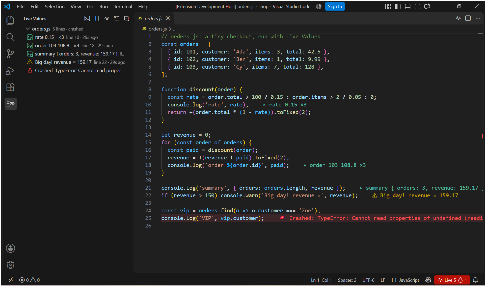
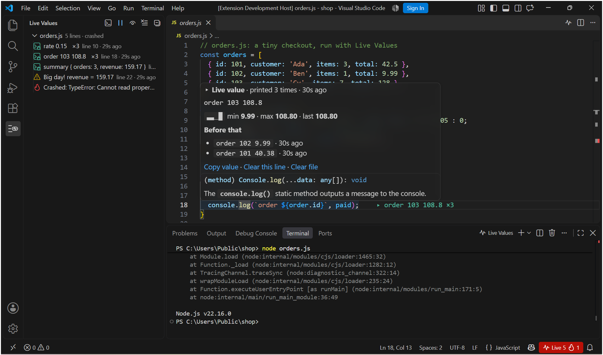

  

# Veyra Live Values

**See what your code prints, right next to the line that printed it.**

Stop jumping between your code and the terminal to work out which `console.log` printed what. Run your Node.js code as usual and Veyra Live Values shows every value, warning, error and crash **at the end of the line that produced it**, live, as your program runs. **Free, 100% local, nothing to configure.** By the makers of [Veyra Studio](https://veyraeditor.com).

- ▸ **Values at the end of the line:** `console.log`, `info`, `debug`, `warn` and `error`, in the editor, as they happen.
- 💥 **Crashes where they happen:** an uncaught exception or unhandled rejection marks the line that threw, in red.
- 🔁 **Loops, counted:** `×12` when a line runs twelve times, with the latest value shown.
- 📈 **Numbers, charted:** hover a line that prints numbers for a tiny chart, with min, max and last.
- 🔎 **The whole value on hover:** objects in full, plus the values it printed before.
- 📋 **A Live Values sidebar** listing every line that printed, by file. Click to jump there.
- ▶️ **Run This File** in one click, JavaScript or TypeScript.
- 🐞 **Works with the debugger** (F5 and launch.json) and any terminal command: `node`, `npm run dev`, `tsx`, `ts-node`, `nodemon`, Express, NestJS…

---

## How to use it

1. Install Veyra Live Values.
2. Open a **new** terminal in VS Code (terminals that were already open need a restart).
3. Run your code as you always do: `node app.js`, `npm start`, `npx tsx src/index.ts`…

That's it. Every value appears next to the line that printed it, and in the **Live Values** sidebar.

Or open a `.js` or `.ts` file and click **Run This File with Live Values** (the pulse icon at the top right of the editor).

## The hover

Hover any line that printed something to see:

- the **full value**, with objects expanded, not cut off;
- **how many times** it printed and when;
- a **chart** of the numbers it printed, with min, max and last;
- the **values before** the latest one;
- **Copy value**, **Clear this line** and **Clear file**.

## Every run starts clean

When you run your program again, the values from the previous run are cleared in each file it prints from, so what you see is always the latest run. Values follow their lines while you edit: add a line above and they move down with it.

## TypeScript

Values land on your `.ts` lines, not the compiled JavaScript, whenever source maps exist: with **tsx**, **ts-node**, or `tsc` with `"sourceMap": true`. **Run This File** runs TypeScript with `tsx`.

## Private by design

Live Values never sends anything anywhere. It adds a small hook to Node in VS Code's terminals (through `NODE_OPTIONS`). The hook writes what your code prints to a file on your computer, and the extension reads that file. It only records calls made from **your project's code**: logs from inside `node_modules` are shown at the line of your code that called them, and programs outside your project aren't recorded at all. It never changes what your program prints or how it behaves.

## Commands

| Command | What it does |
| --- | --- |
| **Live Values: Run This File with Live Values** | Runs the current `.js` or `.ts` file in the Live Values terminal. |
| **Live Values: New Live Values Terminal** | Opens a terminal ready to run anything. |
| **Live Values: Pause** / **Resume** | Stops and starts collecting new values. |
| **Live Values: Show or Hide Values in the Editor** | Keeps the sidebar but hides the values after your lines. |
| **Live Values: Clear Values in This File** / **Clear All Values** | Starts fresh. |
| **Live Values: Copy Value** | Copies the full value of the line under the cursor. |

Click **Live** in the status bar for all of them.

## Settings

| Setting | Default | |
| --- | --- | --- |
| `veyraLiveValues.enabled` | `true` | Turn Live Values on or off. Off leaves Node exactly as it was (restart open terminals). |
| `veyraLiveValues.inline` | `true` | Show values at the end of their lines. |
| `veyraLiveValues.maxLength` | `120` | The longest value shown in the editor. Hover for the rest. |
| `veyraLiveValues.clearOnNewRun` | `true` | Clear the previous run's values when you run again. |
| `veyraLiveValues.debugSessions` | `true` | Also collect values from Node debug sessions. |
| `veyraLiveValues.statusBar` | `true` | Show the Live counter in the status bar. |

Colours: `veyraLiveValues.value`, `veyraLiveValues.warning`, `veyraLiveValues.error` and `veyraLiveValues.crashBackground` in `workbench.colorCustomizations`.

## Good to know

- Works with **Node.js 16 and newer**, on Windows, macOS and Linux.
- Code that runs in the **browser** (React, Vue, Svelte front ends) isn't covered yet: Live Values sees what runs in Node, including servers, scripts, tests, CLIs and the server side of full-stack apps.
- If a value doesn't appear, check that the program was started in a terminal opened **after** Live Values was installed. VS Code marks older terminals with a warning icon; restart them.

## More from Veyra

Veyra Live Values is part of a family of free, local-first tools by the makers of [Veyra Studio](https://veyraeditor.com), the lightweight VS Code alternative: [Veyra Hotspots](https://veyraeditor.com/hotspots), [Veyra Blast Radius](https://veyraeditor.com/blast-radius), [Veyra Error Lens](https://veyraeditor.com/error-lens) and [more](https://veyraeditor.com/extensions).

Found a bug or have an idea? [Open an issue](https://github.com/fcopensource/veyraeditor/issues).
