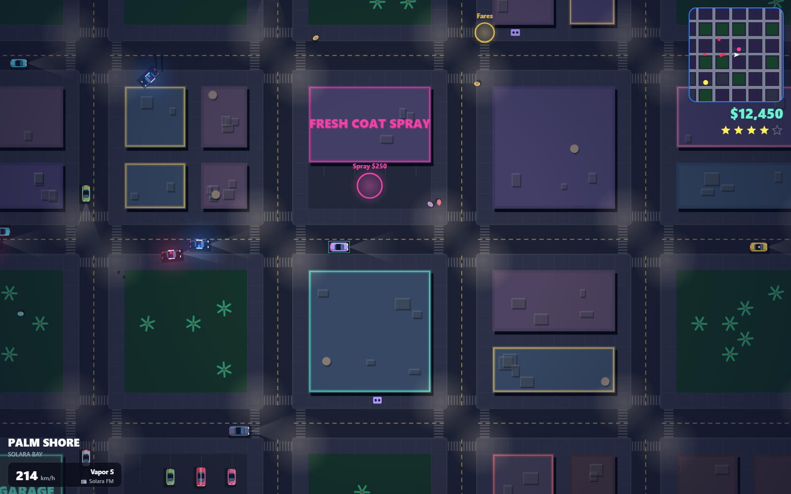

# Neon Getaway

**A retro neon driving game for your coffee break, right in the editor.** Hop into any car, drift through Solara Bay at night, race, and play the story missions.

Press **Ctrl+Alt+G** (**Cmd+Alt+G** on Mac), or click **🚀 Neon Getaway** in the status bar.

## A whole city to drive

Solara Bay has four districts: the towers of **Neon Heights**, the palms of **Palm Shore**, the warehouses of **Dockside** and the streets of **Old Town**. Traffic drives its lanes and turns at junctions, people walk the sidewalks, and the sea glitters around a city of neon rooftops.

- **Drive any car.** Walk up to one and press **E**. Parked, passing, even a police car, if you dare.
- **Drive it like you mean it.** Arcade handling, top speeds over 250 km/h, and **Space** for handbrake drifts that leave tyre marks.
- **Four cars to buy** at Rico's Garage: the Bolt Compact, the Pulse GT muscle car, the Vapor S and the Hyperion supercar.

## Police chases

Take a car in front of a cop, speed past one, or bump one, and you're **wanted**: up to five stars. More stars bring more police, and they hunt you through the streets. Get out of sight long enough and they lose you. Or pay for a fresh coat at the spray shop. Stop next to a cop and you're **busted**: a fine, and back to the station.

## Missions

Six story missions for **Rico** the mechanic and **Nova** the racer: a timed delivery, a car to bring in, a chase across town, a street race against the Street Kings and **The Last Run**. Between missions, take taxi fares and hunt for **20 hidden mixtapes**.

## A bonus for your work

Saving files gives you a small in-game bonus to spend on cars in the game (there's a daily limit). It's game money only: nothing real is paid or earned. Turn it off with `neonGetaway.paycheck`.

## Controls

| Key | |
|---|---|
| **W A S D** or arrows | Drive or walk |
| **Space** | Handbrake: drift! |
| **E** | Get in or out of a car |
| **Enter** or **F** | Start a job, open the garage, spray shop, taxi fares |
| **Shift** | Run |
| **Tab** | City map |
| **R** · **M** · **H** | Radio station · sound on/off · horn |
| **Esc** or **P** | Pause |

## Good to know

- **Free, offline, no account.** No ads, no tracking, nothing sent anywhere. Your progress is saved in VS Code.
- **Sound** is a synthwave radio and engine made live by the game. It starts only after you press a key, and **M** turns it off (or set `neonGetaway.sound` to false).
- **No weapons, no gore.** People always dive out of the way.
- **Settings:** `neonGetaway.statusBar` (the status bar button), `neonGetaway.paycheck` (the in-game bonus for saving files), `neonGetaway.sound`.
- **Start over** with *Neon Getaway: Start Over* in the Command Palette.

Made by [FlightCoders](https://flightcoders.com). MIT licensed.
