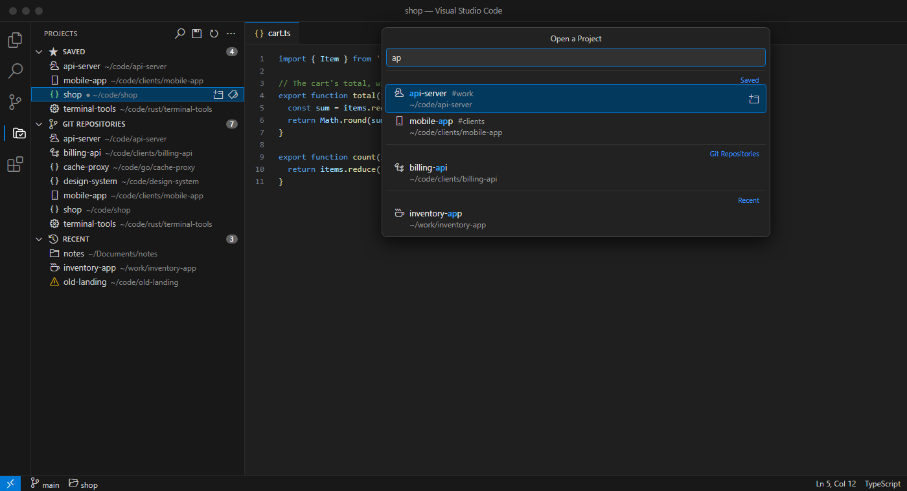

# Project Manager Veyra

**Switch between your projects in a keystroke.** Save the folders you work in as projects, find every Git repository on your disk, and jump back to recent folders, from one sidebar and one search box.

Press **Shift+Alt+P**, type a few letters of the project, and press **Enter**.

## Everything in one place

- **Saved projects.** Click 💾 in the Projects view (or run *Project Manager: Save Project*) to save the open folder. Right-click any folder in the Explorer to save it too.
- **Git repositories, found for you.** Choose the folders you keep code in, like `~/code`, and every repository inside shows up. Dependencies, build output and hidden folders are skipped.
- **Recent folders.** The folders VS Code opened lately, without digging through *File → Open Recent*.
- **The kind of project at a glance.** Node.js, Python, Rust, Go, Java, .NET, PHP, Ruby, Dart and C/C++ projects get their own icon.

## Switch fast

- **Shift+Alt+P** opens a search box with all your projects: saved first, then repositories, then recent folders.
- **Enter** opens the project here. The window button next to it opens a new window.
- The **status bar** shows the project you're in. Click it to switch.
- Right-click a project to open it in a new window or a terminal, copy its path, or show it in your file manager.

## Organise

- **Tags.** Give projects tags like `work`, `clients` or `learning`, and group the sidebar by tag.
- **Sort** by name, by the most recently opened, or in the order you saved them.
- **Edit by hand.** Your projects live in a plain `projects.json`. Run *Edit projects.json* to change it; the sidebar updates when you save.
- **On every computer.** Set `veyraProjects.projectsLocation` to a synced folder (OneDrive, Dropbox, iCloud) to share your list.
- Folders that no longer exist are flagged, so you can tidy up.

## Settings

| Setting | |
|---|---|
| `veyraProjects.scanFolders` | Folders to look for Git repositories in |
| `veyraProjects.scanDepth` | How deep to look (default 4) |
| `veyraProjects.ignoreFolders` | More folder names to skip |
| `veyraProjects.openInNewWindow` | Open projects in a new window by default |
| `veyraProjects.sortBy` | `name`, `recent` or `saved` |
| `veyraProjects.groupByTag` | Group saved projects by tag |
| `veyraProjects.showRecent` · `recentLimit` | The Recent section |
| `veyraProjects.showInStatusBar` | The project name in the status bar |
| `veyraProjects.projectsLocation` | Where `projects.json` is kept |

Already using a `projects.json` from another project manager? Point `veyraProjects.projectsLocation` at its folder: the same format works.

## Good to know

- **Free, offline, no account.** Nothing is sent anywhere.
- It never changes your folders: removing a project only removes it from the list.

Made by [FlightCoders](https://flightcoders.com), the team behind the [Veyra](https://veyraeditor.com) editor. MIT licensed.
