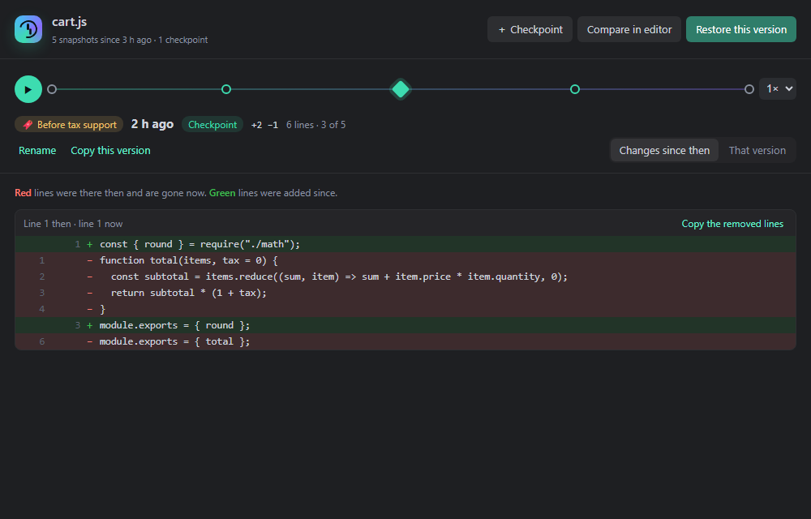
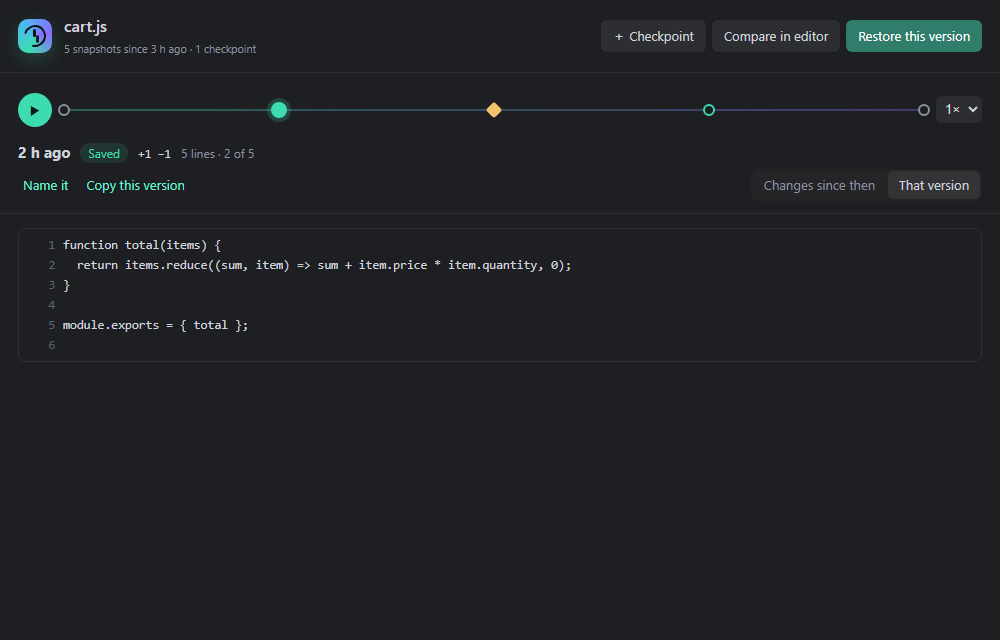

  

# Veyra Rewind: Time Travel for Your Code

**Every version of every file, without a single commit.**

You deleted a function an hour ago and need it back. An experiment went wrong and Ctrl+Z won't go back far enough. A file vanished. Git can't help, because none of it was ever committed.

Rewind keeps a quiet history of every file you open, edit and save. Drag a slider to see the file at any moment, press Play to watch it evolve, and bring back anything in one click. **Automatic, offline and private:** nothing to set up, and nothing ever leaves your computer. By the makers of [Veyra Studio](https://veyraeditor.com).

- ⏪ **Scrub through time.** A timeline of every save, every pause in typing and every checkpoint. Use the slider or the arrow keys.
- ▶️ **Play the story.** Watch the file change step by step, at 1× to 8× speed.
- 🔍 **Find deleted code.** Search for text that was in any file but isn't there any more, like `calculateTotal`, across your whole history.
- ♻️ **Restore anything.** Restore a whole version (Ctrl+Z undoes it), or compare it in VS Code's diff editor and revert a single block.
- 🗑️ **Bring back deleted files.** A file you deleted, even outside VS Code, is one command away.
- 🔖 **Checkpoints.** Name a moment, like "before the refactor", and it's kept forever.

---

## How it works

Open the panel with the **⟲ history button** in the editor title bar, the status bar counter, **Ctrl+Alt+Z** (**⌘⌥Z** on macOS), or **Rewind: Rewind This File** in the Command Palette.

- **Changes since then** shows what's different between that moment and the file now: red lines were there then and are gone now, green lines were added since. **Copy the removed lines** grabs a deleted block.
- **That version** shows the whole file as it was.
- **Compare in editor** opens VS Code's own diff editor, where the arrows revert single blocks.
- **Restore this version** puts it back as one edit, so **Ctrl+Z** undoes the restore.

### When snapshots are taken

| Moment | Kept |
|---|---|
| You open a file | its starting point |
| You save | always |
| You pause typing | at most every 30 seconds (adjustable) |
| You take a checkpoint (**Ctrl+Alt+S**) | always, with your name, forever |
| You delete or restore a file | the version just before |

Unchanged text is never stored twice, and snapshots are compressed. Rewind keeps everything from the last 24 hours, then one per 10 minutes for a week, then one per hour, up to 30 days. Checkpoints never expire.

## Commands

| Command | What it does |
|---|---|
| **Rewind This File** | Opens the timeline for the current file |
| **Take a Checkpoint…** | Names the file as it is now |
| **Find Deleted Code…** | Searches everything you ever deleted |
| **Restore a Deleted File…** | Brings back a file that's gone |
| **Compare With a Past Version…** | Opens the diff editor against any snapshot |
| **Restore a Past Version…** | Picks a snapshot and restores it |
| **Delete History for This File** | Removes its history and checkpoints |
| **Show History Storage** | How much space history uses, and where |

## Settings

| Setting | Default | |
|---|---|---|
| `veyraRewind.enabled` | `true` | Keep history of the files you open, edit and save |
| `veyraRewind.captureInterval` | `30` | While typing, at most one snapshot per this many seconds |
| `veyraRewind.maxSnapshotsPerFile` | `500` | Checkpoints are always kept |
| `veyraRewind.maxAgeDays` | `30` | Older snapshots are cleaned up (not checkpoints) |
| `veyraRewind.maxFileSizeKB` | `1024` | Larger files aren't tracked |
| `veyraRewind.exclude` | `[]` | Extra globs to leave alone, like `**/*.log` |
| `veyraRewind.statusBar` | `true` | Show the snapshot count in the status bar |

Dependencies (`node_modules`), build output (`dist`, `build`, `out`, `.next`), `.git`, lock files, source maps, minified and binary files are never tracked.

## Private by design

History is stored in VS Code's private storage for this extension, on your computer only. There's no account, no network access and no telemetry. **Show History Storage** opens the folder, and **Delete History for This File** removes a file's history.

## Rewind and Git

Git keeps the versions you commit. Rewind keeps everything in between: the experiment you abandoned, the function you deleted before lunch, the file you never added. Use both.

---

Made with ♥ by [Flight Coders](https://veyraeditor.com). Free and open source under the MIT license. Found a bug or have an idea? [Open an issue](https://github.com/fcopensource/veyraeditor/issues).
