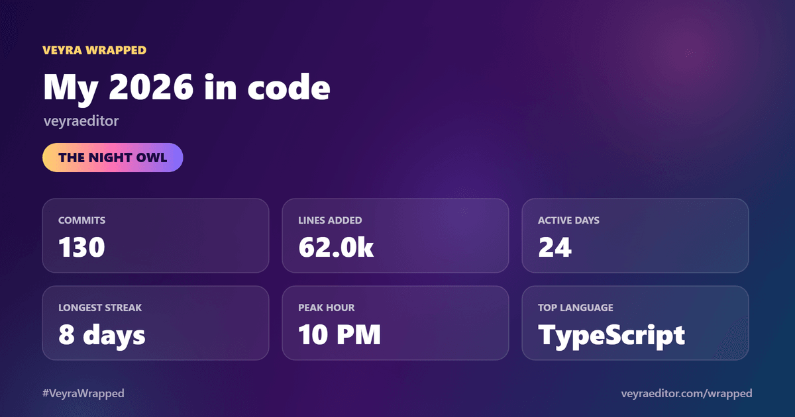
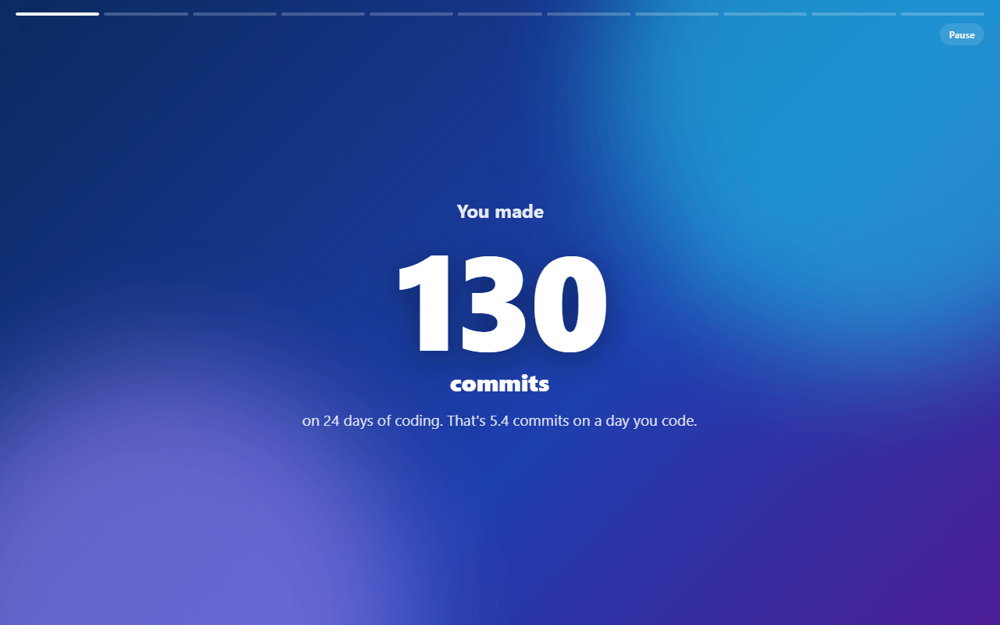
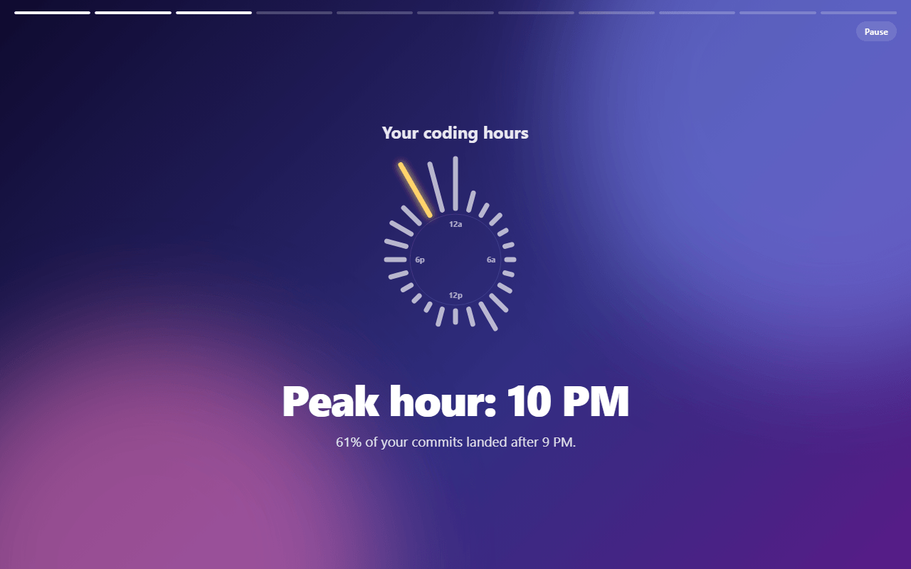
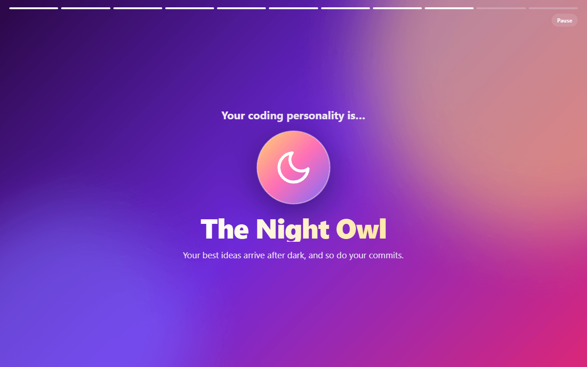

# Veyra Wrapped: Your Year in Code

**Your Git history, told as a story you'll want to share.** How many commits you made, how many lines you wrote, the hour your code comes alive, your longest streak, your top languages and files, your favourite words, and your coding personality. Then save a card for X or LinkedIn.

## Watch your year

Open a repository and run **Veyra Wrapped: Show My Year in Code** from the Command Palette (<kbd>Ctrl</kbd>+<kbd>Shift</kbd>+<kbd>P</kbd>), or click the ✨ button in the Source Control view. Pick this year, the last 12 months or all time, and your story plays like a set of stories on your phone: tap or press <kbd>→</kbd> to skip ahead, <kbd>←</kbd> to go back and <kbd>P</kbd> to pause.

| | |
| :--- | :--- |
|  |  |

## What's in your Wrapped

- **Commits and active days**, and how many commits you make on a day you code
- **Lines added and removed**, with lockfiles, builds and minified files left out so only your work counts
- **Your coding hours** on a 24-hour clock, in your own timezone, and your peak hour
- **Your favourite day** to ship, and how much of your work happens at weekends
- **Your longest streak** and your busiest day
- **Your top languages** and **the files you couldn't stop editing**
- **Your favourite words** in commit messages, and your biggest commit
- **Your coding personality**: the Night Owl, Early Bird, Weekend Warrior, Refactorer, Bug Hunter, Marathoner, Architect or Steady Shipper

## Share it

The last slide is a share card, drawn sharp at 2400 × 1260. **Save image** writes a PNG, and **Copy image** puts it on your clipboard to paste into X, LinkedIn or Slack. Tag it **#VeyraWrapped**.

## Just you, or the whole team

Wrapped finds your commits with the name and email Git uses for you. Run **Veyra Wrapped: Show the Team's Year in Code** for everyone's work together, with the people behind it.

## Private by design

Wrapped reads your history with your own Git on your own computer. Nothing is uploaded, there's no account and no telemetry.

## Settings

| Setting | Default | |
| :--- | :--- | :--- |
| `veyraWrapped.period` | `ask` | Wrap this year, the last 12 months or all time without asking |
| `veyraWrapped.autoPlay` | `true` | Move to the next slide on its own |

---

Made by the [Veyra](https://veyraeditor.com) team. More at [veyraeditor.com/wrapped](https://veyraeditor.com/wrapped).
