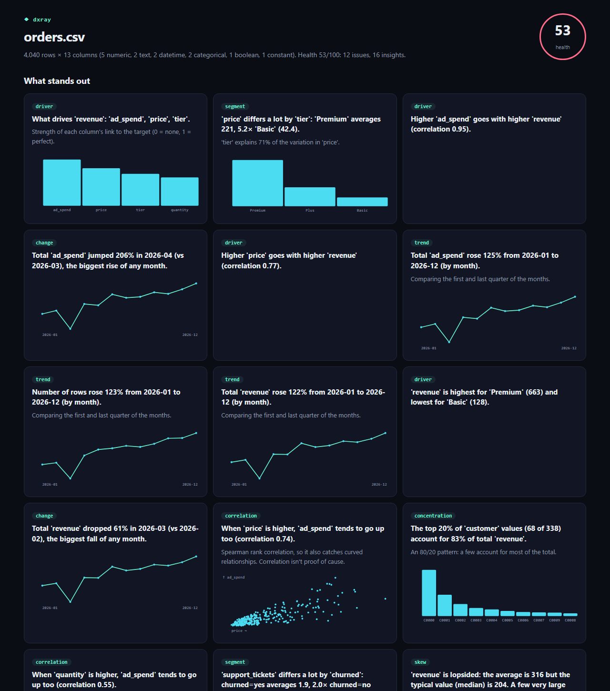

# dxray: an X-ray for your data

**One line tells you what's wrong with a dataset and what stands out in it, in plain English.** Then clean it, share
a report, or ask Claude about it.

```python
import dxray as dx

dx.scan(df, target="revenue")
```

```text
◆ dxray  orders.csv  4,040 rows × 13 columns. Health 53/100: 12 issues, 16 insights.

What stands out
  → What drives 'revenue': 'ad_spend', 'price', 'tier'.
  → 'price' differs a lot by 'tier': 'Premium' averages 221, 5.2× 'Basic' (42.4).
  → Total 'revenue' rose 122% from 2026-01 to 2026-12 (by month).
  → Total 'revenue' dropped 61% in 2026-03 (vs 2026-02), the biggest fall of any month.
  → The top 20% of 'customer' values (68 of 338) account for 83% of total 'revenue'.

Data problems
  ● 'price' holds numbers stored as text (like '$46.25', '$95.54'), so you can't sum or average it.
       fix: df['price'] = pd.to_numeric(df['price'].astype(str).str.replace(r'[,$€£₹¥%\s]', '', regex=True), errors='coerce')
  ● 'region' spells the same value different ways (like 'NORTH', 'North', 'north').
       fix: df['region'] = df['region'].str.strip().str.title()
  ● 40 rows (1.0%) are exact duplicates of another row.
       fix: df = df.drop_duplicates()
```

```console
pip install dxray
```

Works with pandas DataFrames (and polars or pyarrow tables, dicts, lists) and with CSV, Excel, Parquet and JSON files.
Python 3.9+. Only needs pandas and numpy.

## Why dxray

Every analysis starts the same way: twenty minutes of `df.info()`, `df.describe()`, `value_counts()` and squinting,
before you know whether the data can be trusted or where the story is. dxray does that pass for you, in one line, and
writes it in sentences:

- **What each column really is.** Not just `object` and `int64`: money stored as text, dates stored as text, yes/no
  columns, IDs, emails, categories, free text, constants.
- **What's wrong, and the exact fix.** Missing values (including "N/A", "-", "null" hiding as text), duplicates,
  repeated IDs, the same category spelled three ways, stray spaces, numbers stored as text, impossible outliers,
  sentinel values like -999. Every problem comes with the pandas line that fixes it.
- **What stands out.** The strongest relationships, the groups that differ, what drives the column you care about,
  trends over time and the biggest jumps and drops, 80/20 concentration, and averages that lie. Ranked, so the best
  come first.
- **A health score** from 0 to 100, so you can see at a glance whether the data is ready.

## A report you can share

```python
report = dx.scan(df, target="revenue")
report                         # in Jupyter: a rich report with charts
report.to_html("report.html")  # one self-contained page: email it, attach it, open it anywhere
report.to_markdown()           # for a PR, a wiki, a notebook cell
report.to_json()               # for code
```



## Clean it, safely

```python
clean_df, log = dx.clean(df)
print(log)
```

```text
dxray cleaned 4,040 rows → 4,000 rows, 7 changes
  ✓ 'order_date': dates stored as text are now dates
  ✓ 'region': merged different spellings of the same value (111 values)
  ✓ 'price': 31 values like 'N/A' or '-' are now missing values
  ✓ 'price': numbers stored as text are now numbers
  ✓ Dropped 40 duplicate rows
```

`dx.clean()` only makes mechanical fixes and tells you every one. It never drops outliers or fills in missing values:
those are decisions about your data, so the report tells you about them and you decide. Your original DataFrame is
left untouched.

## Made for AI

**Give any AI model your dataset, without pasting a million rows.** `dx.for_llm(df)` describes the data in compact
Markdown: every column with its type and statistics (computed from all rows), a few sample rows, the problems and the
findings. A few thousand tokens instead of your whole table.

```python
prompt = dx.for_llm(df, target="revenue")
```

**Or just ask.** With `pip install "dxray[ai]"` and an
[Anthropic API key](https://console.anthropic.com), `dx.ask()` sends that description to Claude:

```python
dx.ask(df, "Why did revenue drop in March, and is the data trustworthy enough to report?")
```

Claude sees dxray's description, not your rows. Asking several questions about the same data reuses the cached
description, so follow-ups are faster and cheaper. Choose `effort="low"`, `"medium"` (default) or `"high"`, a
`model=`, or pass your own `client=anthropic.Anthropic(...)`.

## From the command line

```console
$ dxray sales.csv --target revenue --html report.html
$ dxray sales.csv --clean sales_clean.csv
$ dxray sales.csv --llm > context.md
$ dxray sales.csv --ask "Which region is growing fastest?"
$ dxray sales.csv --json
```

## Good to know

- **Big data:** columns are profiled on every row; the relationship and trend analysis uses a 200,000-row random
  sample, so a million-row table still takes seconds.
- **Correlation isn't cause.** dxray tells you what moves together and what differs; deciding why is still your job.
- **Trends** use the table's main date column (it skips birth, signup and join dates), leave out thin periods, and
  can't be faked by a few typos like a quantity of 9,999.
- **Private by default.** Everything runs locally. Only `dx.ask()` sends anything anywhere: the description, to the
  Anthropic API.

## License

MIT. Made by [FlightCoders](https://flightcoders.com), the team behind the [Veyra](https://veyraeditor.com) editor.
